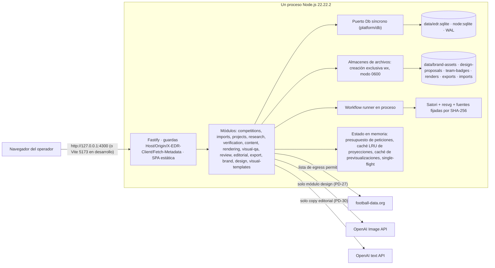
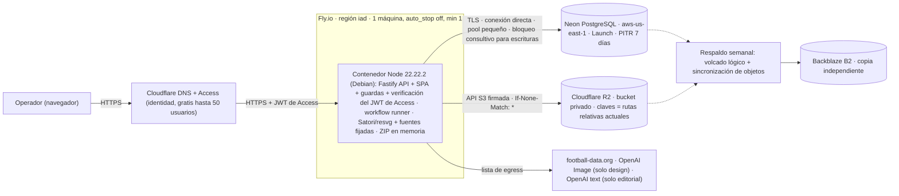
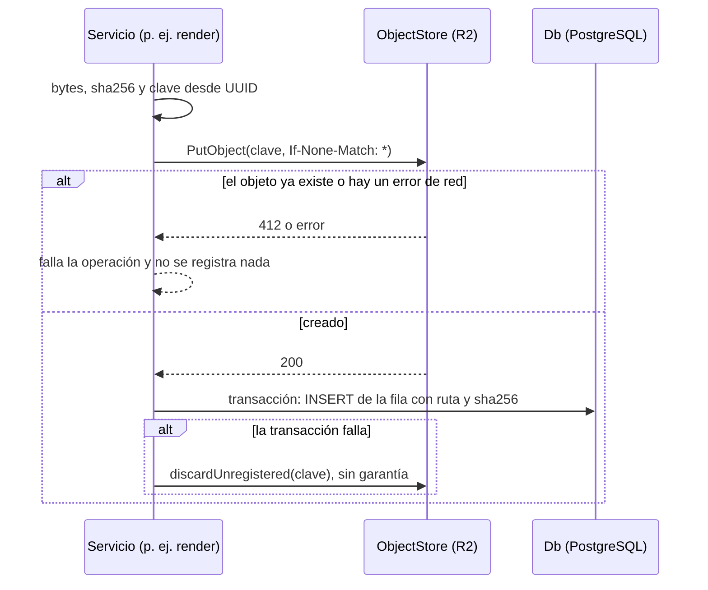
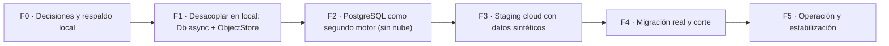

# CLOUD-ARCH-01 — Assessment de migración a infraestructura cloud

> **Estado: CLOSED — PO ACCEPTED / IMPLEMENTATION DEFERRED (2026-11-16, PD-38).** El Product Owner aprobó este
> assessment como entregable, consideró la migración técnicamente viable y pospuso su implementación como decisión
> definitiva. La versión 1.0 sigue siendo una
> aplicación personal y local, con SQLite y almacenamiento de archivos local (sección 15). La recomendación y el plan
> de las secciones 1 y 7 a 14 **no se adoptan**: se conservan como análisis para reconsiderarlo más adelante.
>
> El assessment no cambió código, contratos, esquemas, dependencias ni migraciones. No se creó ningún recurso cloud ni
> se contrató ningún proveedor. No se subieron archivos ni se copiaron datos reales a servicios externos. La base SQLite
> real no se modificó.

**Leyenda.** **[V]** significa verificado en el código, en los datos locales o en la documentación oficial citada.
**[S]** significa supuesto o estimación. Los precios se consultaron en las páginas oficiales el **2026-11-16**. Son
tarifas publicadas, no cotizaciones, y pueden cambiar.

## 0. Verificación inicial, alcance y método

| Comprobación | Resultado |
| --- | --- |
| Rama, HEAD y estado | `main` en `471aeab` (`471aeaba7bad71c46cd9c390154a6dc9dd55b83c`), igual a `origin/main`, árbol limpio [V] |
| Cierre de TEAM-DISPLAY-01 | CLOSED — PRODUCT OWNER ACCEPTED (2026-11-16), commit `538da27`. Está en `main` desde el merge `c7014d4` [V] |
| Migraciones 0037 y 0038 | Ambas en `main`. 0037 reconstruye `content_generation_items` para admitir `score_not_supported`. 0038 añade `managed_teams.display_name` (NULL o 1–32 caracteres) [V] |
| Base local (copia WAL en el scratchpad) | Versión 38, `integrity_check` ok, 0 violaciones de clave foránea, 7,33 MB [V] |
| Archivos locales | 270 archivos referenciados por la base, 0 faltantes. 3 originales de importación huérfanos (14 KB) [V] |

**Método.**

- Leí el código de `apps/server`, `apps/web`, `packages/contracts`, la configuración y el Source of Truth.
- Reconstruí el esquema aplicando las 38 migraciones en una base en memoria.
- Hice conteos de solo lectura sobre una **copia** de `data/edr.sqlite` con sus archivos `-wal` y `-shm`.
- Medí tamaños de archivos con `stat`, sin leer su contenido.
- Medí el render con las pruebas existentes, que usan datos sintéticos.
- Investigué proveedores solo en páginas oficiales (sección 5.6).

**Nota para el Source of Truth.** La fila de TEAM-DISPLAY-01 todavía dice «no merge, push or deploy». Eso cambió cuando
el Product Owner pidió el merge y el push a `main` (`c7014d4`, `471aeab`). Corregirlo es una tarea documental separada
(decisión D-14). **Corregido el 2026-11-16** por la decisión 8 de PD-38 (sección 15).

## 1. Resumen ejecutivo

**Conclusión: la migración es viable** técnica, operativa y económicamente. No hace falta reescribir el backend, sino
adaptar tres capas: persistencia, archivos y exposición de red. Las invariantes de la sección 2.3 se conservan. El
motor Satori/resvg, las aprobaciones independientes y el historial de exportaciones no cambian de diseño.

**Hallazgos que deciden el plan:**

1. **El costo principal es que el puerto `Db` es síncrono, no el dialecto SQL.**
   - El puerto se construye sobre `DatabaseSync` de `node:sqlite`. Hay 488 sentencias preparadas en 45 archivos de
     producción y 75 transacciones [V].
   - La regla T10-F15 prohíbe `await` dentro de una transacción. La atomicidad de las guardas depende del bloqueo
     global de escritura de `BEGIN IMMEDIATE` [V].
   - Todo driver de PostgreSQL para Node.js es asíncrono. Por eso el primer paso es volver asíncrono el puerto
     **todavía sobre SQLite**, con las suites actuales como red de seguridad. Solo después se cambia de motor.
2. **La aplicación no tiene autenticación.** Está diseñada para un solo operador en loopback (PD-05, SC-01, SC-02,
   AD-14). El esquema de configuración obliga a `127.0.0.1` y a listas de hosts loopback [V]. Publicarla exige una
   decisión del Product Owner sobre el control de acceso. Recomiendo un proxy de identidad delante (Cloudflare
   Access), con verificación del token en la API y sin construir cuentas en v1.
3. **Los archivos son privados, inmutables y verificados.**
   - Hay unos 274 MB en seis categorías. Cada archivo tiene ruta relativa y SHA-256 en la base. Se escribe con creación
     exclusiva y solo se sirve a través de la API con `no-store` [V].
   - No se necesitan transformaciones ni CDN. Cloudinary no aporta una capacidad que el producto use y es la opción más
     cara en los tres escenarios.
   - Basta un almacenamiento de objetos compatible con S3 que garantice la creación exclusiva. Cloudflare R2 la
     garantiza de forma atómica con `If-None-Match` [V].
4. **El motor de render y los trabajos largos requieren un proceso siempre activo.**
   - Las corridas del workflow, las generaciones de propuestas y las importaciones siguen ejecutándose después de
     responder la petición HTTP [V].
   - El estado en memoria (presupuesto de peticiones, caché de previsualizaciones, single-flight) supone una sola
     instancia [V].
   - Una función serverless facturada por petición no sirve. Un único contenedor siempre encendido sí.
5. **Hoy no existe ningún respaldo.** Ningún proceso respalda `data/`. Es un riesgo actual, independiente de la nube.

**Recomendación:**

| Pieza | Elección |
| --- | --- |
| Base de datos | **Neon PostgreSQL**, plan Launch, región AWS us-east-1 |
| Archivos | **Cloudflare R2**, bucket privado |
| Control de acceso | **Cloudflare Access** (plan gratuito, hasta 50 usuarios) |
| Aplicación | **Un contenedor siempre encendido en Fly.io** (iad, 1 GB), que sirve API, SPA y motor como hoy |
| Copia independiente | Base y archivos replicados en otro proveedor |

- **Costo de infraestructura estimado al mes 12 [S]:**
  - Escenario A (personal): **≈ USD 12/mes**.
  - Escenario B (operación habitual): **≈ USD 20–34/mes**.
  - Escenario C (crecimiento): **≈ USD 52–91/mes**.
  - El costo de IA va aparte (sección 6.4).
- **Por qué esta opción:**
  - Es la más barata en A y B.
  - Incluye restauración a un punto en el tiempo de hasta 7 días por USD 0,20/GB-mes de historial. En Supabase, la
    misma protección cuesta unos USD 100/mes adicionales [V].
  - Permite ensayar la migración en ramas de la base.
  - Solo usa interfaces estándar (PostgreSQL y S3), así que se puede cambiar de proveedor.
- **Alternativa sólida:** Supabase (opción A) con precio plano de USD 25/mes, si el Product Owner prefiere un solo
  proveedor de base y archivos con factura fija.

**Plan:** cinco fases (sección 13). Las dos primeras no tienen costo cloud, se ejecutan en local y se pueden revertir.
La fase 1 por sí sola deja la aplicación lista para cualquier proveedor.

## 2. Arquitectura actual basada en código real

### 2.1 Vista de componentes

### 2.2 Hechos del código

| Aspecto | Hecho [V] | Ubicación |
| --- | --- | --- |
| Runtime | Node.js 22.22.2. Un solo proceso sirve la API (`/api/v1`, 107 rutas) y la SPA compilada (`@fastify/static`, AD-06). El cliente web usa rutas relativas del mismo origen | `apps/server/src/app.ts`, `platform/http/server.ts`, `apps/web/src/api/client.ts` |
| Exposición | `server.host` solo admite `127.0.0.1`. `allowedHosts` y `allowedOrigins` solo admiten `127.0.0.1` y `localhost`. `trustProxy` está desactivado. No se envían cabeceras CORS | `platform/config/schema.ts`, `platform/http/guards.ts` |
| Persistencia | `DatabaseSync` con `foreign_keys=ON`, WAL y `busy_timeout` de 5 s. Transacciones `BEGIN IMMEDIATE` con savepoints anidados. Rechaza trabajo asíncrono dentro de una transacción | `platform/db/sqlite.ts`, `db.ts` |
| Migraciones | 38 archivos SQL, aplicados al arrancar. Cada uno corre en su propia transacción y verifica `PRAGMA foreign_key_check` | `platform/db/migrations.ts`, `apps/server/migrations/` |
| Archivos | Cinco implementaciones de almacén sobre `fs`. Construyen las rutas solo con UUID, comprueban contención con `realpath`, escriben con la bandera `wx` y modo 0600, y nunca sobrescriben ni borran (AD-19, OD-08) | `modules/brand/storage.ts` (también propuestas de diseño y escudos), `rendering/files.ts`, `export/files.ts`, `imports/originals.ts` |
| Render | Satori produce un SVG con glifos como trazos. `renderAsync` de resvg corre fuera del hilo principal, con `loadSystemFonts: false` y solo las tres fuentes fijadas por SHA-256. Las imágenes entran como `data:` URI construidos desde bytes verificados | `rendering/renderer.ts`, `rendering/fonts.ts` |
| Trabajos largos | Al arrancar, las corridas activas se marcan como `interrupted`. Las generaciones de diseño corren con `void this.#run(id)` después de responder. Al apagar, las corridas activas se cancelan | `workflow/runner.ts`, `modules/design/service.ts`, `main.ts` |
| ZIP | Se construye en memoria (método store, máximo 102 entradas) a partir de los archivos persistidos de la exportación. Antes se verifica el SHA-256 de cada archivo contra la base. No se guarda | `modules/export/zip.ts`, `export/service.ts` |
| Límites de IA | El cupo diario y el gasto mensual se calculan desde filas persistidas, así que sobreviven a reinicios | `modules/design/service.ts`, `modules/editorial/service.ts` |
| Secretos | Solo vienen de variables de entorno (`.env.local` en local). Los JSON de configuración rechazan claves con nombre de secreto | `platform/config/keys.ts`, `main.ts` |
| Respaldos | No existe ningún proceso ni documento de respaldo | búsqueda en `README.md`, `docs/local-setup.md` y `apps/server/scripts` |

### 2.3 Invariantes que se preservan

Son las de PD-36. Ninguna fase del plan las modifica:

1. La IA de imágenes solo genera propuestas visuales de plantillas reutilizables, desde el módulo `design`.
2. El editor configura plantillas, capas, bindings y recursos, en versiones. Una versión publicada es inmutable, y lo
   garantizan dos triggers.
3. Los datos deportivos vienen de fuentes verificadas y de competiciones locales.
4. Satori/resvg genera las imágenes finales con plantillas publicadas y snapshots deportivos. Es determinista.
5. La generación de carruseles no usa IA generativa de imágenes.
6. La IA editorial escribe los copies a partir del contexto deportivo.
7. Las aprobaciones gráficas y editoriales son independientes (PD-33).
8. Las exportaciones históricas conservan sus bytes, su manifiesto y sus hashes (AD-17, AD-19, PD-34).

## 3. Inventario de SQLite

### 3.1 Esquema (versión 38)

| Elemento | Cantidad [V] | Observación |
| --- | --- | --- |
| Tablas | 63 (62 de dominio + `schema_migrations`) | Todas `STRICT`. No hay vistas ni columnas generadas |
| Migraciones | 38 archivos, 1.972 líneas | 15 reconstrucciones de tabla (crear `_new`, copiar, borrar, renombrar). 6 usan `PRAGMA defer_foreign_keys` (0008, 0021, 0022, 0023, 0032 y 0037) |
| `CHECK` en el DDL vivo | 291 | Listas cerradas, `length()` y reglas cruzadas entre columnas |
| JSON | 49 `CHECK (json_valid(...))` y verificaciones `json_type` | 18 columnas `*_json`, más `render_model`, `version_set`, `text`, `fields` y otras |
| Claves foráneas | 117 referencias en el DDL vivo | Casi todas `RESTRICT` o `NO ACTION`. 3 `CASCADE` y 1 `SET NULL` |
| Ciclos de claves foráneas | `elements` ↔ `element_versions` y `design_generations` ↔ `design_proposals`. Autorreferencias en `workflow_runs` y `editorial_versions` | Condicionan el orden de carga en PostgreSQL |
| Índices | 155 (65 explícitos y 90 automáticos de `UNIQUE` o `PRIMARY KEY`) | 10 índices parciales. Uno con expresión `ifnull(...)` |
| Triggers | 6 | Pertenencia de un participante a la competición, coherencia ronda–etapa del partido, e inmutabilidad de las versiones publicadas de plantilla (`RAISE(ABORT)`) |
| `AUTOINCREMENT` | 4 tablas de eventos | Columna `sequence` |
| Identificadores | `TEXT`: UUID en minúsculas y slugs de catálogo (por ejemplo competiciones y temporadas) | No pueden pasar al tipo `uuid` de PostgreSQL |
| Fechas | `TEXT` ISO-8601 UTC con milisegundos (`2026-10-30T01:17:42.927Z`) | Se ordenan y comparan como texto |
| Booleanos | `INTEGER` 0/1 con `CHECK` | `toSqlBoolean` / `fromSqlBoolean` |
| Montos | `REAL` | Costos de IA |

### 3.2 Datos reales (copia)

| Medida | Valor [V] |
| --- | --- |
| Tamaño | 7,33 MB |
| Tablas más grandes | `sports_field_provenance` 3.168 filas, `match_result_history` 1.222, `external_identity_mappings` 880, `element_fact_refs` 814, `competition_matches` 766, `qa_results` 579 |
| Objetos de producto | 12 proyectos, 11 carruseles, 107 versiones de elemento, 8 exportaciones, 14 versiones de plantilla (11 publicadas), 20 propuestas, 53 equipos, 26 escudos, 14 recursos de marca, 12 versiones editoriales |
| Valores JSON más grandes | `element_versions.render_model` hasta 59,9 KB. `badge_snapshot_json` hasta 1,6 KB |

### 3.3 Acceso desde el código

| Módulo | Sentencias `prepare` | Transacciones | | Módulo | Sentencias `prepare` | Transacciones |
| --- | ---: | ---: | --- | --- | ---: | ---: |
| competitions | 166 | 27 | | design | 23 | 3 |
| content | 35 | 4 | | imports | 23 | 1 |
| workflow | 28 | 3 | | editorial | 22 | 4 |
| projects | 27 | 5 | | visual-templates | 22 | 7 |
| review | 27 | 6 | | export | 17 | 2 |
| verification | 27 | 3 | | brand | 16 | 6 |
| rendering | 16 | 1 | | research | 13 | 1 |
| visual-qa | 12 | 1 | | platform + providers | 14 | 1 |

En total hay **488 sentencias en 45 archivos y 75 transacciones** [V], repartidas en 17 archivos `repository.ts` y otros
28 archivos. Toda sentencia usa placeholders posicionales `?`. No hay parámetros con nombre ni SQL construido desde la
entrada (T10-F14). Las pruebas tienen 47 archivos con SQL propio y 20 abren SQLite directamente.

### 3.4 Clasificación del impacto de cambiar a PostgreSQL

Categorías: **1** compatible con cambios mínimos · **2** necesita adaptación · **3** necesita rediseño específico ·
**4** presenta riesgo de migración.

| # | Elemento | Dónde [V] | Cat. | Adaptación propuesta |
| --- | --- | --- | :-: | --- |
| P-01 | Placeholders `?` | Todo el SQL | 1 | El adaptador traduce `?` a `$n` una vez por texto SQL y lo guarda en caché |
| P-02 | SELECT, INSERT, UPDATE y JOIN estándar | La mayoría de las sentencias | 1 | Sin cambio |
| P-03 | `ON CONFLICT ... DO UPDATE/NOTHING` con `excluded.` | 5 sentencias | 1 | La sintaxis es la misma en PostgreSQL |
| P-04 | `INSERT OR IGNORE` | `verification/repository.ts` (2) y soporte de pruebas | 2 | `ON CONFLICT DO NOTHING` |
| P-05 | Igualdad tolerante a NULL `IS ?` e `IS NEW.` | `import-preview.ts`, `import-local-state.ts`, triggers 0005 y 0008 | 2 | `IS NOT DISTINCT FROM` |
| P-06 | `json_extract`, `json_each`, `json_object`, `json_valid` en consultas | `brand/repository.ts`, `content/repository.ts`, `visual-templates/project.ts`, `competitions/badges/sql.ts` | 2 | `->>`, `json_array_elements`, `json_build_object` |
| P-07 | Columnas JSON como `TEXT` con `json_valid`/`json_type` | 49 CHECK | 2 | Tipo **`json`**, no `jsonb`, porque conserva el texto exacto; `json_typeof` sustituye a `json_type`. Hay que configurar el driver para que devuelva el JSON como texto, que es lo que espera `readJsonColumn` |
| P-08 | `ORDER BY rowid` como desempate | 28 apariciones en 12 archivos (`facts`, `observations`, `retrievals`, `manual_approvals`, `approvals`, `final_approvals`, `exports`, `imports`, `projects`, `brand_assets`, `editorial_generations`, `match_result_history`) | **4** | PostgreSQL no tiene `rowid`. Hay que añadir una columna de secuencia explícita y llenarla con el `rowid` de SQLite al migrar; si no, cambia el orden de las listas históricas |
| P-09 | Orden y comparación de texto | Todo `ORDER BY` sobre texto (nombres, IDs, fechas ISO) | **4** | SQLite compara bytes (`BINARY`). PostgreSQL usa la collation de la base. Hay que declarar `COLLATE "C"` en las columnas de texto para conservar el orden byte a byte |
| P-10 | Tipos devueltos | 13 `count(*)` y 10 `sum()` | 2 | En `node-postgres`, `bigint` y `numeric` llegan como cadenas. Hay que registrar parsers de `int8` a `number` con verificación de entero seguro, y usar `double precision` para `REAL` |
| P-11 | `INTEGER` de 64 bits | Tamaños, posiciones, `sequence` | 1 | `integer` donde cabe, `bigint` en identidades |
| P-12 | `AUTOINCREMENT` | 4 tablas de eventos | 1 | `GENERATED ALWAYS AS IDENTITY` y `setval` al máximo después de copiar |
| P-13 | Índices parciales y de expresión | 10 índices | 1/2 | Sintaxis compatible; `ifnull` pasa a `coalesce` |
| P-14 | Triggers con `RAISE(ABORT)` | 6 | 2 | Funciones PL/pgSQL con `RAISE EXCEPTION`. La inmutabilidad de las versiones publicadas debe conservarse igual |
| P-15 | Introspección `sqlite_schema` / `sqlite_master` | Runner de migraciones; `visual-qa/repository.ts` lee el DDL de `qa_results` para saber qué checks admite | 3 | En QA visual, sustituir la lectura del DDL por una constante versionada o por `pg_get_constraintdef` |
| P-16 | `PRAGMA foreign_keys`, `journal_mode`, `foreign_key_check` y `defer_foreign_keys` | Adaptador y runner | 2 | PostgreSQL siempre aplica las claves foráneas. El runner usa otras verificaciones |
| P-17 | Mapeo de errores de restricción | `constraintKind()` usa códigos extendidos de SQLite. El código lo compara 20 veces: 15 con `unique`, 3 con `foreign_key` y 2 con `primary_key`, siempre junto a `unique` | 2 | Mapear SQLSTATE `23505`, `23503`, `23514` y `23502`. PostgreSQL no distingue entre clave primaria y única, pero el código ya las trata igual |
| P-18 | **Puerto síncrono** | `Db.prepare().get/all/run` y `transaction(work)` síncronos; el adaptador rechaza trabajo que devuelva una promesa | **3** | Puerto asíncrono (sección 8.1). Es el mayor cambio por volumen |
| P-19 | **Atomicidad de las guardas** (T10-F15) | Guardas de una corrida activa por proyecto, generaciones concurrentes, gasto mensual y otras comprobaciones previas a una escritura | **3** | En PostgreSQL, `READ COMMITTED` no serializa escritores. Se replica `BEGIN IMMEDIATE` tomando `pg_advisory_xact_lock(<constante>)` al iniciar cada transacción de escritura |
| P-20 | Escritura de archivo dentro de una transacción | `imports/originals.ts` escribe el original de forma síncrona durante la aplicación de la importación, a propósito | 3 | Con almacenamiento de objetos la escritura es asíncrona y de red. Hay que subir el objeto antes de la transacción y registrarlo dentro |
| P-21 | Historial de migraciones | 38 migraciones SQLite con reconstrucciones de tabla | 3 | No se pueden reproducir en PostgreSQL. Hace falta una línea base PostgreSQL equivalente al esquema v38, y una migración nueva por dialecto desde 0039 |
| P-22 | Concurrencia | Una conexión, WAL, `busy_timeout` | 3 | Pool pequeño. `AsyncLocalStorage` enruta las sentencias de una transacción a su conexión |
| P-23 | Fechas `TEXT` | Todas las columnas `*_at` | 1 | Mantener `text` con `COLLATE "C"` en la primera migración: los manifiestos y los hashes usan las cadenas exactas. Pasar a `timestamptz` sería una decisión posterior |
| P-24 | Pruebas y fixtures | 47 archivos con SQL propio; `PRAGMA foreign_keys = OFF` en `visual-qa/test/support.ts`; `INSERT OR IGNORE` en `content/test/support.ts` | 2 | Ejecutar las suites de integración y contrato contra ambos motores durante la transición |
| P-25 | `rowid` y `VACUUM` | Tablas con clave primaria `TEXT` | 4 | En SQLite, `VACUUM` puede renumerar el `rowid` de tablas sin `INTEGER PRIMARY KEY`. El desempate por `rowid` ya es frágil hoy. La columna de secuencia de P-08 lo corrige |
| P-26 | Respaldo | No existe | 4 | Es un riesgo actual (sección 12) |

**Lectura.** Unas 25 sentencias necesitan cambios de dialecto (P-04 a P-08 y P-15) y unas 450 solo necesitan `await`.
El rediseño real se concentra en `platform/db`: puerto asíncrono, transacciones, bloqueo y tipos. Reescribir los
repositorios no hace falta.

## 4. Inventario de archivos y activos

### 4.1 Categorías

| Categoría | Ubicación y forma [V] | Volumen actual [V] | Crea | Consulta | Modifica o elimina | Relación con la base |
| --- | --- | --- | --- | --- | --- | --- |
| Propuestas visuales IA y fondos generados | `design-proposals/<uuid>.png` | 27 PNG, 63,2 MB, ~2,34 MB de media | `design` (OpenAI Image, PD-27) | Revisión de diseño, editor de plantillas, render (fondo de una plantilla publicada) | Nadie. El borrado lógico solo marca `deleted_at`; 19 de 20 filas lo tienen y sus archivos siguen | `design_proposals.file_path`, `sha256`, `background_file_path`, `background_sha256` |
| Recursos de Mi marca: fondos, referencias de estilo, logo oficial y mascota **KETSI** | `brand-assets/<uuid>.png` | 14 PNG, 34,7 MB: 9 fondos, 3 referencias de estilo, 1 logo oficial, 1 mascota | Carga del operador | Render, plantillas, diseño (referencias) | Nadie. Solo `active`, `deactivated_at` y `deleted_at` | `brand_assets.file_path`, `sha256`, `usage_policy`, `official` |
| Escudos de equipos (PD-28) | `team-badges/<uuid>.png` o `.jpg` | 26 archivos (23 PNG, 3 JPG), 9,8 MB; 21 activos, 5 retirados | Carga manual con autorización declarada | Render y snapshot de escudos del proyecto (v4) | Nadie. Un escudo retirado conserva su archivo | `team_badges.file_path`, `sha256`, `authorization_confirmed`, `source_note` |
| Renders finales | `renders/<projectId>/<versionId>.png` | 92 PNG, 111,0 MB. Mediana 0,07 MB (plantillas del motor); p90 2,99 MB (plantillas con fondo) | Etapa `rendering` | Revisión, QA visual y exportación | Nadie. Una nueva versión es un archivo nuevo | `element_versions.image_path`, `image_sha256` |
| Exportaciones: PNG, `caption.txt`, `copy-editorial.txt` y `manifest.json` | `exports/<projectId>/<exportId>/` | 8 exportaciones, 102 archivos, 55,4 MB; manifiesto de ~36 KB de media | `export` (cada descarga nueva, PD-34) | Historial y descarga en ZIP | Nadie. Carpeta nueva con creación exclusiva | `exports.directory`, `manifest_sha256`; `export_files.sha256` por archivo |
| ZIP | No se guardan; se arman en memoria | 0 | `export.downloadExport` | Navegador | — | Derivados de `export_files`, verificados por hash |
| Originales de importación | `imports/<importId>/original.<json/csv/form.json>` | 12 archivos, 56 KB; **3 huérfanos sin fila** | `imports` | Auditoría y reprocesamiento | Nadie | `imports.original_path`, `original_sha256` |
| Plantillas publicadas | No son archivos: son filas (`layers_json`, `assets_json`) que apuntan a un fondo de marca o a una propuesta | 14 versiones | Editor | Render | Una versión publicada es inmutable por trigger | `visual_template_versions` |
| Snapshots | No son archivos: `projects.badge_snapshot_json` y textos y versiones en filas | — | Proyectos y contenido | Render | Inmutables por diseño | Base |
| Fuentes | `assets/fonts/` en el repositorio (1,0 MB, 3 TTF de licencia OFL) | Fijadas por SHA-256 | Repositorio | Render | Solo con un cambio versionado | `rendering/fonts.ts` |
| Base de datos | `data/edr.sqlite` y sus archivos `-wal` y `-shm` | 7,4 MB | Servidor | Servidor | Migraciones | — |
| Evidencias y temporales | No hay directorio temporal del servidor. Los reportes de Playwright y la caché de navegadores están fuera de `data/` e ignorados por git | — | Pruebas | — | — | Ninguna |

**Imágenes externas importadas.** No hay importación de imágenes desde URL. PD-28 prohíbe obtener escudos por URL. Las
únicas imágenes de terceros son las que carga el operador: escudos, fondos y referencias de estilo.

**Total actual:** 273 archivos (270 referenciados y 3 huérfanos) y unos 274 MB, más 7,4 MB de base de datos.

### 4.2 Propiedades por categoría

| Categoría | Visibilidad | Inmutable | Retención | Respaldo |
| --- | --- | --- | --- | --- |
| Propuestas IA | Privada | Sí | Indefinida (AD-19). Posible política para propuestas borradas (D-08) | Sí. Una propuesta usada como fondo de una plantilla publicada es irrecuperable |
| Mi marca, logo y KETSI | Privada y protegida | Sí | Indefinida | Sí, crítico |
| Escudos | Privada. La autorización del operador no implica publicación abierta | Sí | Indefinida, incluidos los retirados, porque los snapshots históricos los referencian | Sí, crítico |
| Renders | Privada | Sí | Indefinida. Las versiones reemplazadas (4 hoy) siguen referenciadas | Sí |
| Exportaciones | Privada | Sí | Indefinida. Son la prueba de lo entregado | Sí, crítico |
| ZIP | Privada, efímera | — | No se guardan | No: se regeneran exactos desde la exportación |
| Originales de importación | Privada | Sí | Indefinida | Sí |
| Huérfanos | Privada | — | Decisión D-08 | Se conservan en el respaldo local congelado |

**Conclusión del inventario.** Nada necesita ser público. Nada necesita transformaciones. Todo es de escritura única. Los
ZIP no necesitan almacenamiento propio. Las exportaciones sí: son el registro histórico inmutable. Las rutas relativas
guardadas en la base pueden usarse **tal cual como claves de objeto**: `renders/
/<v>.png` y
`exports/
/<x>/01.png` no cambian. Así ninguna fila de la base necesita reescribirse al migrar los archivos.

## 5. Comparación de proveedores

### 5.1 Lo que la aplicación necesita

- PostgreSQL estándar, sin funciones propietarias.
- Almacenamiento de objetos privado con creación exclusiva.
- Respaldo restaurable.
- Una región en el este de EE. UU., que es la más cercana a Guatemala con presencia de los proveedores.
- Límites de gasto.

No necesita transformaciones de imagen, CDN público, autenticación del proveedor, funciones serverless ni tiempo real.

### 5.2 Base de datos [V salvo indicación]

| Aspecto | Supabase | Neon |
| --- | --- | --- |
| Plan gratuito | 500 MB de base, 1 GB de almacenamiento, 5 GB de egress. **Sin respaldos automáticos.** **Se pausa tras 1 semana de inactividad** | 100 CU-h y 1 GB por proyecto. Escala a cero a los 5 min sin poder desactivarlo. Ventana de restauración de 6 h. 5 GB de transferencia |
| Plan para producción | **Pro, desde USD 25/mes**: 8 GB de disco (luego USD 0,125/GB), USD 10 en créditos de cómputo (una instancia Micro de 1 GB y CPU compartida), 250 GB de egress (luego USD 0,09/GB), 100 GB de almacenamiento (luego USD 0,0213/GB) | **Launch, por uso y sin mínimo**: USD 0,106/CU-h y USD 0,35/GB-mes. Escala a cero (se puede desactivar). 500 GB de transferencia (luego USD 0,10/GB) |
| Respaldo y restauración | Pro: respaldos diarios con 7 días de retención. PITR como complemento: ~USD 100/mes (7 días), 200 (14), 400 (28); RPO de 2 min. **Los respaldos no incluyen los objetos de Storage** | Launch: ventana de historial de **hasta 7 días** con restauración instantánea, a USD 0,20/GB-mes de historial. Scale: hasta 30 días |
| Ramas para ensayos | No evaluado | Sí: 10 en el plan gratuito; en Launch, USD 1,50/mes por rama adicional |
| Pooling | Supavisor: sesión en el puerto 5432 y transacción en el 6543, solo IPv4. Conexión directa por IPv6, o IPv4 con complemento | PgBouncer en modo transacción (endpoint `-pooler`); sin `SET`, `LISTEN` ni tablas temporales. Conexión directa disponible |
| Arranque en frío | No aplica: la instancia está siempre encendida | «Unos cientos de milisegundos» al despertar |
| Control de gasto | Tope de gasto en Pro, activo por defecto. No cubre cómputo, PITR ni IPv4 | Notificaciones de gasto, límites de consumo que suspenden el cómputo y límites de autoescalado |
| Regiones cercanas | us-east-1, us-east-2, us-west-1, us-west-2, ca-central-1, sa-east-1. Sin México | AWS us-east-1, us-east-2, us-west-2, sa-east-1. Azure está cerrado a proyectos nuevos |
| Propiedad | — | Su sitio indica «from Databricks»; adquisición anunciada el 2025-05-14 |

### 5.3 Almacenamiento de objetos [V salvo indicación]

| Aspecto | Supabase Storage | Cloudinary | Neon Object Storage | Cloudflare R2 (alternativa evaluada) |
| --- | --- | --- | --- | --- |
| Precio | 100 GB incluidos en Pro; luego USD 0,0213/GB | Créditos: Free 25/mes; Plus USD 99/mes (89 anual) con 225; Advanced USD 249/mes (224 anual) con 600. 1 crédito = 1 GB guardado, o 1 GB de ancho de banda, o 1.000 transformaciones | 5 GB por proyecto en Free; USD 0,023/GB-mes en Launch y Scale | USD 0,015/GB-mes; 10 GB-mes gratis |
| Egress | Cuenta en el egress de Supabase | Consume créditos | Cuenta en la transferencia de Neon | **Gratis** |
| Privacidad | Buckets privados por defecto; URLs firmadas | `private` y `authenticated` con URLs firmadas. La autenticación por token o cookie requiere Advanced | URLs prefirmadas | Privado por defecto; acceso con credenciales S3 [S para el detalle de políticas] |
| Creación exclusiva (no sobrescribir) | Protocolo S3 compatible; **sin versionado**; un objeto borrado se pierde | Guarda los archivos «tal cual» por defecto. Una transformación entrante reemplaza el original | Subconjunto de S3; versionado no aplicado | **`If-None-Match` en `PutObject`, evaluado de forma atómica** |
| Respaldo | No lo cubren los respaldos de la base | Respaldo disponible en todos los planes, desactivado por defecto; cuenta como almacenamiento | No documentado | No documentado (se usa una copia independiente) |
| Madurez | Producto establecido | Producto establecido | Sin etiqueta de madurez en la documentación; solo US East (Ohio, N. Virginia), Frankfurt y Singapur | Producto establecido |
| Encaje | Bueno | **Bajo**: la plataforma vale por transformaciones y CDN, que el producto no usa, y su precio por créditos crece con almacenamiento y ancho de banda | Prometedor, sin evidencia de madurez | **Bueno**, y es el mismo proveedor de Cloudflare Access |

### 5.4 Combinaciones pedidas y evaluadas

| Opción | Evaluación |
| --- | --- |
| **A. Supabase PostgreSQL + Supabase Storage** | Viable y simple: un proveedor y factura fija de USD 25. Contras: el RPO es de 24 h salvo PITR (~USD 100/mes), y Storage queda fuera de los respaldos, así que hace falta una copia independiente igual. **Alternativa recomendada si se prefiere precio plano** |
| **B. Neon PostgreSQL + Cloudinary** | Técnicamente viable, pero Cloudinary no aporta una capacidad usada. Cuesta USD 99/mes desde que se superan 25 créditos (alrededor del mes 9 en el escenario A) y USD 249/mes en C. **Descartada** |
| **C. Supabase PostgreSQL + Cloudinary** | Paga dos veces el almacenamiento, porque Pro ya incluye 100 GB. Es la combinación más cara. **Descartada** |
| **D. Neon PostgreSQL + Neon Object Storage** | Un solo proveedor y costo parecido a la recomendada. Hoy no hay evidencia documental de su madurez ni de su soporte de escritura condicional. **Reevaluar en la fase 3** como sustituto de R2 |
| **E. Neon PostgreSQL + Cloudflare R2** | La más barata en A y B. PITR de 7 días por centavos. Escritura exclusiva atómica verificada. Interfaces estándar. **Recomendada** |
| **Línea base no administrada: SQLite en un volumen + respaldo continuo** | Casi no cambia el código de la base, con un costo parecido al de E (~USD 12 en A) [S]. Pero no es un servicio administrado, depende de un solo disco y de una herramienta de réplica externa, y no permite separar la aplicación de los datos. **No recomendada como destino**; queda como contingencia si el Product Owner prioriza llegar a la nube sin tocar la persistencia |

### 5.5 Latencia, regiones, portabilidad y mantenimiento

- **Latencia desde Guatemala** (ping promedio entre servidores, WonderNetwork, no conexiones domésticas) [V]:
  - Miami 24 ms, Atlanta 37 ms, Washington 51 ms, Dallas 52 ms, Ciudad de México 76 ms, Los Ángeles 81 ms, São Paulo
    130 ms.
  - Ningún proveedor de base tiene región en Miami, México o Centroamérica.
  - US East (Virginia) queda unos 50 ms por encima del mínimo posible y unos 80 ms por debajo de São Paulo.
  - Para una interfaz de operador esa latencia es aceptable [S]. Conviene medirla desde la conexión real del operador
    antes de elegir (fase 3).
- **La aplicación y la base deben estar en la misma región.**
  - Hoy una página puede ejecutar decenas de consultas, porque en SQLite cada una cuesta microsegundos.
  - Con la base a 50 ms, una página con 40 consultas tardaría unos 2 s.
  - Dentro de la misma región (~1–2 ms por consulta) el efecto es tolerable [S].
- **Portabilidad.** La recomendación solo usa PostgreSQL estándar y la API S3. No usa la autenticación, el RLS, las
  funciones ni la Data API de ningún proveedor. Cambiar de proveedor sería un volcado lógico, una copia de objetos y
  nuevas variables de entorno.
- **Mantenimiento.** Neon y Supabase administran el motor, los parches y los respaldos. R2 no tiene servidores que
  mantener. El único componente propio es el contenedor de la aplicación.

### 5.6 Fuentes consultadas (2026-11-16)

- Supabase:
  - https://supabase.com/pricing
  - https://supabase.com/docs/guides/platform/cost-control
  - https://supabase.com/docs/guides/platform/backups
  - https://supabase.com/docs/guides/database/connecting-to-postgres
  - https://supabase.com/docs/guides/platform/compute-and-disk
  - https://supabase.com/docs/guides/platform/regions
  - https://supabase.com/docs/guides/storage/buckets/fundamentals
  - https://supabase.com/docs/guides/storage/cdn/fundamentals
  - https://supabase.com/docs/guides/storage/serving/image-transformations
  - https://supabase.com/docs/guides/storage/s3/compatibility
- Neon:
  - https://neon.com/pricing
  - https://neon.com/docs/introduction/plans
  - https://neon.com/docs/introduction/scale-to-zero
  - https://neon.com/docs/connect/connection-pooling
  - https://neon.com/docs/introduction/regions
  - https://neon.com/docs/storage/overview
  - https://neon.com/docs/storage/s3-compatibility
  - https://neon.com/blog/neon-and-databricks
- Cloudinary:
  - https://cloudinary.com/pricing
  - https://cloudinary.com/pricing/compare-plans
  - https://cloudinary.com/documentation/developer_onboarding_faq_free_plan
  - https://cloudinary.com/documentation/eager_and_incoming_transformations
  - https://cloudinary.com/documentation/control_access_to_media
  - https://cloudinary.com/documentation/backups_and_version_management
- Cloudflare y Backblaze:
  - https://developers.cloudflare.com/r2/pricing/
  - https://developers.cloudflare.com/r2/api/s3/api/
  - https://www.cloudflare.com/zero-trust/products/access/
  - https://www.backblaze.com/cloud-storage/pricing
- Hosting:
  - https://docs.fly.io/about/pricing
  - https://docs.fly.io/reference/regions
  - https://docs.fly.io/launch/autostop-autostart
  - https://render.com/pricing
  - https://render.com/docs/free
  - https://railway.com/pricing
  - https://docs.railway.com/reference/regions
  - https://cloud.google.com/run/pricing
  - https://docs.cloud.google.com/run/docs/configuring/billing-settings
  - https://docs.cloud.google.com/run/docs/configuring/request-timeout
  - https://docs.cloud.google.com/run/docs/locations
  - https://www.digitalocean.com/pricing/droplets
  - https://www.digitalocean.com/pricing/app-platform
- Acceso y latencia:
  - https://tailscale.com/pricing
  - https://wondernetwork.com/pings/Guatemala

**No verificado:**

- El precio del complemento IPv4 de Supabase y el de sus tamaños de cómputo por encima de Micro.
- La madurez de Neon Object Storage.
- Los términos de uso comercial del plan gratuito de Cloudinary.
- Si Fly.io mantiene la CPU para trabajo en segundo plano sin tráfico (la documentación no lo dice). Se valida en la
  fase 3.
- El precio de un dominio propio.

## 6. Costos en tres escenarios

### 6.1 Supuestos [S], derivados de los datos medidos [V]

| Supuesto | A — Personal | B — Operación habitual | C — Crecimiento |
| --- | --- | --- | --- |
| Operadores | 1 | 2–5 | 6–15 |
| Carruseles por mes | 40 | 200 | 600 |
| Diapositivas por mes (8,4 por carrusel, medido) | ~340 | ~1.700 | ~5.000 |
| Tamaño por diapositiva | 3 MB, conservador (p90 medido 2,99 MB; las plantillas del motor pesan ~0,07 MB) | igual | igual |
| Archivos nuevos por carrusel (render + 1 exportación + 10 % de regeneraciones) | ~50 MB | ~50 MB | ~50 MB |
| Propuestas IA por mes (2,34 MB cada una, medido) | 20 | 100 | 300 |
| Archivos acumulados al mes 12 (incluye ~0,3 GB actuales) | ~25 GB | ~123 GB | ~370 GB |
| Base de datos al mes 12 (~0,5 MB por proyecto; hoy 7,3 MB con 12 proyectos) | ~0,25 GB | ~1,2 GB | ~3,6 GB |
| Transferencia de salida por mes (~7 vistas completas o descargas de ~25 MB por carrusel) | ~7 GB | ~35 GB | ~105 GB |
| Peticiones al almacenamiento | ~1 mil escrituras y decenas de miles de lecturas | ~5 mil escrituras | ~15 mil escrituras; las lecturas por debajo de 10 M |
| Horas con la base activa por mes | ~150 h | ~300 h | ~480 h |
| Tamaño de cómputo de la base | 0,25 CU | 0,25–0,5 CU | 0,5–1 CU |
| Instancia de aplicación | 1 de 1 GB | 1 de 1–2 GB | 1–2 de 2 GB |

### 6.2 Costo mensual estimado de infraestructura al mes 12, en USD [S con tarifas V]

Todas las opciones incluyen los mismos componentes comunes:

| Componente común | A | B | C |
| --- | ---: | ---: | ---: |
| Fly.io (iad): 1 GB a USD 6,70; 2 GB estimado como 2 × 1 GB | 6,70 | 6,70–13,40 | 13,40–27,00 |
| Egress de Fly.io en Norteamérica (USD 0,02/GB) | 0,14 | 0,70 | 2,10 |
| Copia independiente en Backblaze B2 (USD 6,95/TB, 10 GB gratis) | 0,10 | 0,79 | 2,50 |
| Cloudflare Access (gratis hasta 50 usuarios) | 0 | 0 | 0 |
| Dominio propio [S, no verificado] | ~1 | ~1 | ~1 |
| **Subtotal común** | **~7,9** | **~9,2–15,9** | **~19,0–32,6** |

| Opción | Componentes específicos | A | B | C |
| --- | --- | ---: | ---: | ---: |
| **E. Neon + R2 (recomendada)** | Neon: cómputo (0,106 por CU-h), base (0,35/GB) e historial (0,20/GB). R2: 0,015/GB por encima de 10 GB | 4,1 + 0,2 | 8,6–16,6 + 1,7 | 27,4–52,9 + 5,4 |
| | **Total** | **≈ 12** | **≈ 20–34** | **≈ 52–91** |
| **A. Supabase + Storage** | Pro 25 + almacenamiento por encima de 100 GB (0,0213/GB). En C posiblemente más cómputo, sin precio verificado | 25,0 | 25,5 | 30,8 + cómputo |
| | **Total** | **≈ 33** | **≈ 35–41** | **≈ 50–63 + cómputo** |
| | PITR comparable a E (7 días) | +100 | +100 | +100 |
| **D. Neon + Neon Object Storage** | Neon como en E + objetos a 0,023/GB | 4,1 + 0,6 | 8,6–16,6 + 2,8 | 27,4–52,9 + 8,5 |
| | **Total** | **≈ 13** | **≈ 21–35** | **≈ 55–94** |
| **B. Neon + Cloudinary** | Neon como en E + créditos (almacenamiento + ancho de banda): 32 → Plus; 158 → Plus; 475 → Advanced | 4,1 + 99 | 8,6–16,6 + 99 | 27,4–52,9 + 249 |
| | **Total** | **≈ 111** (gratis hasta ~el mes 8) | **≈ 117–132** | **≈ 295–335** |
| **C. Supabase + Cloudinary** | Supabase Pro 25 + Cloudinary como en B | 25 + 99 | 25 + 99 | 25 (+ cómputo) + 249 |
| | **Total** | **≈ 132** | **≈ 133–140** | **≈ 293–307 +** |

**Lectura.**

- La opción recomendada cuesta un 37 % de la opción A en el escenario A, y entre un 57 % y un 83 % en el B, con mejor
  RPO para la base.
- En C las dos opciones se acercan, y Supabase podría salir más barato según el cómputo que necesite. Ese es el punto
  para reevaluar el proveedor. La portabilidad hace viable cambiar.
- Las opciones con Cloudinary multiplican el costo sin aportar una capacidad usada.

**Palancas que reducen costo** (decisiones D-09 y D-10):

- Cabeceras de caché `private, immutable` para imágenes inmutables. Hoy se sirven con `no-store` (OD-41), así que el
  navegador las descarga en cada vista.
- Hacer que las exportaciones referencien el objeto del render en vez de copiarlo. Reduciría el almacenamiento en
  ~45 %.

### 6.3 Costo de transición (una sola vez) [S]

- **Ingeniería:** ~30–45 días-persona (sección 9).
- **Cloud durante staging:** Neon Free o Launch más R2 dentro del plan gratuito, más Fly.io 1 GB durante 4–6 semanas.
  Total de **USD 10–20**.
- **Migración real:** los volúmenes actuales (7 MB de base y 274 MB de archivos) están dentro de los planes gratuitos
  de transferencia.

### 6.4 IA, separada de la infraestructura

| Concepto | Dato medido [V] | A | B | C |
| --- | --- | ---: | ---: | ---: |
| Propuestas visuales (OpenAI Image) | 15 generaciones con costo registrado de USD 1,07 (~0,071 cada una). Tope configurado: USD 10/mes y 20 imágenes/día | 20 → ~1,4 | 100 → ~7,1 | 300 → ~21,3 (**supera el tope**) |
| Copy editorial (OpenAI text) | 2 generaciones, USD 0,045 (~0,0225 cada una). Tope configurado: USD 5/mes y 30/día | 40 → ~0,9 | 200 → ~4,5 (cerca del tope) | 600 → ~13,5 (**supera el tope**) |
| football-data.org | Plan gratuito | 0 | 0 | 0 |
| **Total IA** | | **~2,3** | **~11,6** | **~35** + revisión de topes (PD-27, PD-30) |

Los costos medidos se calcularon con los precios configurados (`checkedOn` 2026-11-05 y 2026-11-10), no con
facturas.

## 7. Arquitectura recomendada

### 7.1 Decisiones por componente

| Componente | Recomendación | Justificación |
| --- | --- | --- |
| Frontend React | Lo sirve el mismo Fastify desde `apps/web/dist`, como hoy (AD-06) | Mismo origen: sin CORS, que AD-14 prohíbe, y sin un segundo despliegue. Separarlo en otro hosting no aporta nada para 1–15 operadores |
| API Fastify | Un contenedor siempre encendido, con 1 vCPU compartida y 1 GB | Los trabajos en segundo plano, el SSE y el estado en memoria exigen una instancia persistente (sección 2.2) |
| Motor de render | En el mismo proceso que la API | Ya es asíncrono (`renderAsync` en el pool de libuv) y determinista. Un worker separado solo se justifica en el escenario C, con una cola en PostgreSQL |
| Trabajos de generación | En el mismo proceso, con `failInterruptedRuns` al arrancar (ya existe) | Los despliegues interrumpen las corridas activas. Hay que desplegar sin trabajos en curso y documentarlo en el runbook |
| Almacenamiento temporal | Ninguno en disco. El ZIP se arma en memoria | El sistema de archivos del contenedor es efímero. No hace falta un volumen |
| Base de datos | Neon Launch en aws-us-east-1, con conexión directa | Pocas conexiones desde un solo servidor. Evita las limitaciones del pooler en modo transacción |
| Archivos | R2, bucket privado, solo leído y escrito por la API | Conserva la verificación por SHA-256, la CSP de archivos y el control de acceso en un único lugar. No requiere URLs firmadas en v1 |
| Logs | stdout de Fastify hacia los logs de la plataforma | Ya no incluyen secretos ni rutas (T10-F10). La retención de la plataforma es suficiente para v1 [S] |
| Respaldos | PITR de Neon (7 días) y una copia semanal independiente en B2 | Ni R2 ni Supabase Storage respaldan objetos |
| Secretos | Variables de entorno en el almacén de secretos de la plataforma | AD-15 y AD-30 ya los exigen por entorno |

### 7.2 Hosting de la aplicación [V para precios]

| Opción | Precio de la opción mínima apta | Encaje |
| --- | --- | --- |
| **Fly.io**, `shared-cpu-1x` 1 GB, iad | USD 6,70/mes; egress USD 0,02/GB | **Recomendada.** Hay que fijar `auto_stop_machines = "off"` y una máquina mínima. Sin volumen. Ashburn está junto a us-east-1 |
| Railway, Hobby | USD 5 + uso (~USD 10/GB-mes de RAM y ~USD 20/vCPU-mes) ≈ USD 15–20 [S] | Viable (región US East en Virginia) |
| DigitalOcean App Platform 1 GiB / Droplet 1 GiB | USD 10 / USD 6 | Viable. El Droplet exige administrar el sistema operativo |
| Render | 0,5 CPU y 512 MB a USD 7 (poca memoria [S]); 1 CPU y 2 GB a USD 25 | Viable con 2 GB. El plan gratuito se apaga tras 15 min |
| Google Cloud Run | Con facturación por instancia y 1 instancia mínima: ~USD 46,6/mes | Viable pero caro. Con facturación por petición, la CPU solo se asigna durante la petición: **no apto** |
| Funciones serverless | — | **No apto**: trabajo posterior a la respuesta, SSE y estado en memoria |

### 7.3 Renderización determinista en cloud

| Requisito | Situación [V] | Consecuencia en cloud |
| --- | --- | --- |
| Dependencias de sistema | `@resvg/resvg-js` 2.6.2 trae binarios precompilados; el lockfile incluye `linux-x64-gnu` y `linux-x64-musl`. Satori, yoga y `opentype.js` son JavaScript o WASM | Imagen Debian (glibc) con Node 22.22.2 y `npm ci`. Sin paquetes del sistema operativo |
| Fuentes | Tres TTF en `assets/fonts`, fijadas por SHA-256; resvg sin fuentes del sistema | Se copian en la imagen. El render no depende de las fuentes del sistema operativo |
| Acceso a imágenes | Solo `data:` URI desde bytes verificados. Sin red ni rutas de archivo | Cada render lee de R2 el fondo (~2,5 MB) y los escudos. Recomiendo una caché LRU en proceso indexada por SHA-256: los objetos son inmutables |
| Recursos remotos | Ninguno: sin `loadAdditionalAsset` | Se mantiene |
| Memoria | El proceso de prueba alcanza 330–350 MB de RSS (incluye Vitest) | 1 GB de RAM. 512 MB es arriesgado [S] |
| Tiempo | 4 diapositivas con plantillas del motor en ~225 ms en un Apple M5 Pro | En una vCPU compartida y con fondos de 3 MB espero varias veces más [S]. Un carrusel de 20 diapositivas podría tardar decenas de segundos. Es aceptable como trabajo en segundo plano y es un criterio de la fase 3 |
| Varias diapositivas | Secuenciales por corrida. Una corrida activa por proyecto | Sin cambio |
| ZIP | En memoria; con 20 diapositivas de 3 MB son ~60 MB | Hay que verificar el límite de tamaño de respuesta del proxy y de la plataforma (fase 3) |
| Concurrencia | `renderAsync` usa el pool de libuv (4 hilos por defecto) | Con 1 vCPU, las corridas concurrentes se reparten la CPU. Es aceptable en A y B |
| Trabajos largos | Corridas, diseño (tiempo máximo de 240 s del proveedor) e importaciones | Requieren CPU asignada sin petición activa. Si no, se pierden |
| Reproducibilidad | R-213 exige bytes idénticos para el mismo modelo, plantilla, fuentes y versiones de bibliotecas. Las exportaciones históricas se sirven desde los bytes guardados, sin volver a renderizar | Los históricos no dependen de la plataforma. Un render nuevo en Linux x64 podría diferir en bytes de uno hecho en macOS arm64 [S]. Hay que medirlo en la fase 3 con renders de referencia |

## 8. Estrategia de migración

### 8.1 Base de datos: SQLite a PostgreSQL

**Principio:** primero se cambia la forma de acceso, todavía sobre SQLite. Luego se añade el motor nuevo. Nunca ambas
cosas a la vez.

1. **Puerto asíncrono** (fase 1):
   - `prepare(sql)` devuelve sentencias cuyas operaciones `get`, `all` y `run` devuelven promesas.
   - `transaction(async (tx) => ...)` devuelve una promesa.
   - Se mantiene la regla equivalente a T10-F15: **dentro de una transacción solo se espera a la base**, nunca a la red
     ni a archivos. Lo garantizan una revisión y una prueba de arquitectura.
   - El adaptador SQLite, que sigue siendo síncrono por dentro, serializa las transacciones con un mutex asíncrono.
     Así ninguna sentencia ajena se cuela en una transacción abierta en la misma conexión.
2. **Adaptador PostgreSQL** (fase 2):
   - Usa `node-postgres` u otro driver equivalente. Es una dependencia nueva que requiere decisión MED-02 (D-11).
   - Pool pequeño (~5 conexiones) y conexión directa.
   - `AsyncLocalStorage` asocia las sentencias de una transacción a su conexión.
   - Cada transacción de escritura empieza con `BEGIN` y `SELECT pg_advisory_xact_lock(<constante>)`. Eso replica la
     serialización de escritores de `BEGIN IMMEDIATE` sin revisar guarda por guarda.
   - Las lecturas fuera de transacción corren en paralelo.
   - Traduce `?` a `$n` y guarda el resultado en caché.
   - Parsers de tipos: `int8` a `number` (con verificación de entero seguro) y `json` a texto.
   - Mapea SQLSTATE a `ConstraintKind`.
3. **Conversión de esquema:**
   - Una línea base PostgreSQL equivalente a la v38, escrita y revisada a mano. Las herramientas automáticas no
     respetan los matices de `STRICT`, `CHECK`, JSON y triggers.
   - Tipos: `text COLLATE "C"`; `json`; `integer` o `bigint`; `double precision`; booleanos como `smallint` con CHECK
     0/1.
   - Identidades para las 4 tablas `AUTOINCREMENT`.
   - Columna de secuencia en las tablas con desempate por `rowid` (P-08).
   - Triggers en PL/pgSQL.
   - Claves foráneas de los ciclos como `DEFERRABLE INITIALLY IMMEDIATE`. Se comportan igual que hoy salvo durante la
     carga.
   - Los nombres de restricciones se conservan donde el código los use.
4. **Migraciones:**
   - `schema_migrations` de PostgreSQL registra las versiones 1–38 con los mismos nombres y las fechas copiadas de
     SQLite, para conservar la trazabilidad.
   - Desde la 0039, cada cambio lleva un archivo por dialecto con el mismo número y nombre.
   - Una prueba compara que ambos directorios tengan las mismas versiones y que los esquemas resultantes sean
     equivalentes por introspección.
   - **Ninguna migración histórica se modifica.**
5. **Adaptación del SQL:** las ~25 sentencias de P-04 a P-08 y P-15. El SQL se mantiene constante (T10-F14), con una
   variante por dialecto solo donde haga falta.
6. **IDs:** se copian tal cual como `text`, UUID y slugs. Ninguna clave se regenera.
7. **Integridad referencial:**
   - La carga corre en una sola transacción, en orden topológico, con `SET CONSTRAINTS ALL DEFERRED` solo para los
     ciclos.
   - Los triggers quedan activos. Los de inserción se cumplen con el orden topológico y los de inmutabilidad solo
     actúan en `UPDATE` y `DELETE`.
   - No se usa `session_replication_role = replica`, porque también desactivaría las claves foráneas.
8. **Dominios con requisitos de fidelidad:**

   | Dominio | Qué se copia | Qué se verifica |
   | --- | --- | --- |
   | Snapshots (`badge_snapshot_json` v1, v3 y v4, render models, textos) | El texto exacto, gracias al tipo `json` | Hash igual al original |
   | Aprobaciones (`approvals`, `final_approvals.version_set` y `version_set_sha256`, `editorial_versions`) | Cada fila | Igualdad fila a fila |
   | Versiones y plantillas publicadas | Igual que hoy | El trigger de inmutabilidad está presente |
   | Historial de exportaciones | `exports` y `export_files` | Hashes iguales |
   | Datos deportivos | `sports_field_provenance` y sus eventos (`manual_override`, `provider_value_json`) | Igualdad, sin normalizar |
   | `display_name` (0038) | `text NULL CHECK (display_name IS NULL OR char_length(display_name) BETWEEN 1 AND 32)` | `char_length` cuenta puntos de código, igual que `length()` de SQLite sobre texto. Se prueba con acentos y emojis |
   | 0037 | La lista de `skip_reason`, incluido `score_not_supported` | La restricción es idéntica |

9. **Herramienta de migración:**
   - Script Node que lee una **instantánea** (`VACUUM INTO` con la aplicación detenida) y escribe en PostgreSQL.
   - Al final ajusta las secuencias con `setval`.
   - Es idempotente sobre una base vacía y aborta ante cualquier diferencia.
10. **Validación de equivalencia** (criterio de corte):
    - Igual número de filas por tabla.
    - Hash SHA-256 por tabla sobre una serialización canónica, ordenada por clave primaria, con los valores normalizados
      del mismo modo en ambos motores: enteros, dobles en representación JS y texto exacto.
    - El orden por `rowid` original coincide con el orden por la nueva secuencia.
    - Sin violaciones de claves foráneas ni de CHECK. PostgreSQL las rechaza al insertar, y además se ejecutan
      consultas de verificación.
    - Las suites de integración y contrato pasan contra la base migrada (copia) en staging.
    - Prueba funcional: descargar todas las exportaciones históricas y comparar el SHA-256 de cada archivo con el
      manifiesto y con `export_files`.
11. **Transacciones y rollback:** sección 12.

### 8.2 Almacenamiento: archivos locales a objetos

**Abstracción `ObjectStore`. Recomiendo introducirla en la fase 1.**

- **Por qué hace falta:**
  - Hoy hay cinco almacenes con la misma lógica de seguridad repetida sobre `fs`.
  - Sin la abstracción, habría que bifurcar cada uno para la nube.
  - Con ella, los almacenes conservan su validación (UUID, nombres de archivo cerrados, límites de tamaño) y delegan
    solo la entrada y salida.
  - Además, el modo local sigue disponible para desarrollo, pruebas, rollback y uso sin conexión.
- **Complejidad:** moderada.
  - Un puerto con `putNew(key, bytes, {contentType, sha256})`, que falla si la clave existe, `get(key, {maxBytes})`,
    `head(key)` y `list(prefix)` (solo para reconciliar).
  - Ninguna operación de borrado salvo `discardUnregistered`, que ya existe.
  - Dos adaptadores (local y compatible con S3) y una batería de pruebas de conformidad que se ejecuta contra ambos.
  - La firma S3 es una dependencia pequeña o un firmador SigV4 propio sobre `fetch`, coherente con la regla de no usar
    SDK de proveedor (D-11).

| Tema | Estrategia |
| --- | --- |
| Identificadores estables | Clave de objeto = ruta relativa actual guardada en la base. Ninguna fila se reescribe |
| Checksums | El SHA-256 se calcula antes de subir y se compara en cada lectura, como ya hacen diseño, importaciones y exportación. Extender la verificación en lectura a todas las categorías |
| Versionado | De dominio, como hoy: cada versión es un objeto nuevo. Ni R2 ni Supabase Storage versionan objetos |
| Prohibición de sobrescritura | `If-None-Match: *` en cada `PutObject`; R2 lo evalúa de forma atómica. La credencial de la aplicación no tiene permiso de borrado salvo para `discardUnregistered` [S: verificar la granularidad de permisos de R2] |
| Archivos privados y originales | Bucket privado. Solo la API lee y entrega, con las cabeceras actuales (CSP de archivo, `nosniff`). El original nunca se transforma |
| URLs firmadas | No en v1. Podrían servir más adelante para descargar ZIP grandes o para publicar automáticamente, fuera de v1.0 según PD-36 |
| CDN | No aplica: son privados y de bajo tráfico |
| Recursos protegidos de marca y escudos | Mismo bucket privado con prefijos separados, o buckets separados (D-06). Nunca públicos |
| Fallo de subida | Mismo orden que hoy: 1) subir el objeto; 2) registrar la fila en la transacción; 3) si la transacción falla, intentar `discardUnregistered`. Lo que quede sin borrar es un huérfano inofensivo, porque nunca se sirve |
| Integridad base–objetos | Un reconciliador de solo lectura recorre las rutas de la base y los objetos: reporta faltantes y huérfanos y verifica hashes por muestreo o completo. Hoy daría 0 faltantes y 3 huérfanos |
| Huérfanos | Se reportan; se borran solo por decisión explícita del operador. AD-19 dice que nada se borra |
| Migración inicial | Se copia cada archivo referenciado con su clave, se verifica el SHA-256 contra la base leyendo el objeto subido, y se resume: 270/270. Los huérfanos se quedan en la instantánea local congelada (D-08) |

### 8.3 Validación del render en cloud

- Se generan renders de referencia en macOS de una muestra de versiones (plantillas del motor, plantillas con fondo,
  con escudos y con nombres de presentación).
- Se repiten en el contenedor Linux y se comparan los hashes.
- **Si son idénticos**, se confirma la reproducibilidad entre plataformas.
- **Si difieren**, se documenta como diferencia de plataforma. Hay que comparar los píxeles para confirmar que solo
  cambia el antialiasing y no el contenido. Los históricos no se ven afectados porque nunca se vuelven a renderizar.

## 9. Impacto en código

| Área | Archivos [V] | Cambio | Tamaño [S] |
| --- | --- | --- | --- |
| Puerto y adaptador SQLite | `platform/db/db.ts`, `sqlite.ts`, `sql.ts`, `errors.ts`, `migrations.ts` | Puerto asíncrono, mutex de transacción e instrumentación del número de consultas por petición | 3–4 días |
| Repositorios y llamadores | 45 archivos, 488 sentencias, 75 transacciones, más sus servicios, etapas y rutas | `await` mecánico; algunas firmas pasan a `async` (las rutas ya lo son) | 6–9 días |
| Adaptador PostgreSQL | Nuevo en `platform/db` | Pool, `AsyncLocalStorage`, bloqueo consultivo, `?` a `$n`, parsers de tipos y SQLSTATE | 3–5 días |
| Esquema y migraciones PostgreSQL | Nuevo directorio de migraciones PostgreSQL con línea base v38 y una prueba de equivalencia de esquemas | Ver 8.1 | 3–5 días |
| Dialecto | ~25 sentencias (P-04 a P-08) y `visual-qa/repository.ts` (P-15) | Variante por dialecto | 2–3 días |
| Importaciones | `imports/originals.ts` y la aplicación de importaciones | Subir el original antes de la transacción (P-20) | 1 día |
| Almacenes de archivos | `brand/storage.ts` (marca, propuestas, escudos), `rendering/files.ts`, `export/files.ts`, `imports/originals.ts` | Puerto `ObjectStore`, adaptadores local y S3, y conformidad | 4–6 días |
| Configuración y red | `platform/config/schema.ts`, `rules.ts`, `platform/http/guards.ts`, `platform/net/allow-list.ts`, `main.ts` | Modo cloud: escuchar en `0.0.0.0` dentro del contenedor, hosts y orígenes HTTPS, `trustProxy` acotado, verificación del JWT de Access (JWKS en la lista de egress), ajustes no secretos de base y almacenamiento | 2–3 días + revisión de seguridad |
| Pruebas | 47 archivos con SQL y 20 que abren SQLite | Suites de integración y contrato contra ambos motores; infraestructura de PostgreSQL de prueba (D-11) | 3–5 días |
| Herramientas | `apps/server/scripts/` | Migrador, verificador de equivalencia y reconciliador | 3–4 días |
| Despliegue | Nuevos: Dockerfile, configuración de Fly.io y CI | Imagen, secretos y health check (hoy no hay un endpoint de salud) | 2–3 días |
| Web | `apps/web` | Sin cambios esperados (mismo origen). Como máximo, manejar la expiración de la sesión de Access | 0–1 día |
| Contrato `http-api` | `contracts/http-api.openapi.yaml` | Sin cambios esperados. Un health check sería una ruta operativa, con decisión propia | — |

**Total estimado [S]: 30–45 días-persona.** Ningún cambio toca la lógica de dominio, las reglas de aprobación, el motor
de render ni las invariantes de la sección 2.3.

## 10. Riesgos y mitigaciones

| ID | Riesgo | Prob. | Impacto | Mitigación |
| --- | --- | :-: | :-: | --- |
| R-01 | El puerto asíncrono rompe la atomicidad de una guarda (T10-F15) | Media | Alto | Bloqueo consultivo global en las escrituras; mutex en el adaptador SQLite; pruebas de concurrencia de las guardas; prohibición de esperas que no sean de la base dentro de una transacción |
| R-02 | Cambia el orden de listas históricas (`rowid`, collation) | Media | Medio | Columna de secuencia poblada desde `rowid`, `COLLATE "C"` y comparación de órdenes en el verificador |
| R-03 | La latencia por consulta degrada páginas con muchas consultas | Media | Medio | Misma región, contador de consultas por ruta desde la fase 1 y corrección de patrones N+1 detectados antes del corte |
| R-04 | La plataforma detiene la CPU o la máquina con un trabajo en curso | Media | Alto | Máquina siempre encendida (`auto_stop off`); prueba de que un trabajo sigue 5 min tras cerrar la petición; desplegar sin trabajos activos |
| R-05 | Pérdida o alteración de datos al migrar | Baja | Crítico | Instantánea congelada, verificador al 100 %, base destino vacía, ventana de rollback |
| R-06 | Un render en Linux no es idéntico en bytes al de macOS | Media | Bajo | Los históricos nunca se re-renderizan; comparación en la fase 3 y documentación de la diferencia |
| R-07 | Sobrescritura o borrado de un activo histórico | Baja | Crítico | `If-None-Match`, credencial sin borrado, copia independiente en B2 y reconciliador |
| R-08 | Fuga de credenciales en la nube | Baja | Alto | Almacén de secretos, rol de base con mínimo privilegio, claves nuevas por entorno y rotación documentada |
| R-09 | Exposición pública de la aplicación sin login | Alta si no se mitiga | Crítico | Access delante y verificación del JWT en la API; la API rechaza cualquier petición sin token válido aunque llegue directo al origen |
| R-10 | Crecimiento de costos de almacenamiento y transferencia | Media | Medio | Límites de consumo de Neon, notificaciones de facturación, palancas D-09 y D-10, y revisión trimestral |
| R-11 | Dependencia de proveedor y cambios de producto (Neon-Databricks) | Media | Medio | Solo PostgreSQL y S3 estándar; volcados lógicos semanales; Supabase como plan B documentado |
| R-12 | Una sola instancia, sin alta disponibilidad | Media | Medio | Aceptable para v1; RPO y RTO definidos (D-12) y runbook de restauración ensayado |
| R-13 | Nuevas dependencias (driver PostgreSQL, firma S3, PostgreSQL de prueba) | Alta | Bajo | Decisión MED-02 por dependencia, versiones exactas y `npm audit` limpio |
| R-14 | La autorización de los escudos (PD-28) no cubre alojarlos en terceros | Baja | Alto | El Product Owner confirma el alcance (D-06) antes de subir escudos |
| R-15 | Hoy no hay respaldo de `data/` | Alta | Crítico | Respaldo local inmediato, independiente de esta iniciativa (D-15) |
| R-16 | Mantener dos dialectos duplica el costo de las migraciones futuras | Alta | Medio | Prueba de equivalencia de esquemas; decidir el retiro de SQLite tras la estabilización (D-07) |

## 11. Requisitos de seguridad

### 11.1 Imprescindibles para operar v1 en la nube

1. **Control de acceso.**
   - Cloudflare Access delante, con la política «solo estas identidades».
   - La API verifica el JWT de Access (firma con JWKS, audiencia y expiración) en un hook `onRequest`.
   - Las guardas actuales (Host, Origin, `X-EDR-Client`, Fetch-Metadata, sin CORS) se mantienen con los valores del
     dominio HTTPS.
   - Hace falta enmendar PD-05, SC-01, SC-02 y AD-14 (D-03, D-04).
   - Tailscale Personal queda excluido: su FAQ lo limita a uso no comercial [V].
2. **TLS** en todos los tramos: navegador a Access, Access a la aplicación, y aplicación a Neon, R2 y proveedores. Con
   PostgreSQL, `sslmode=verify-full`.
3. **Mínimo privilegio en la base.**
   - La aplicación usa un rol solo con DML sobre sus tablas.
   - Las migraciones usan otro rol, propietario del esquema.
   - La aplicación nunca usa el rol administrador.
   - Si se elige Supabase: desactivar la Data API o usar un esquema no expuesto [S: verificar en su documentación al
     implementar].
4. **Almacenamiento.**
   - Bucket privado sin acceso público.
   - La credencial de la aplicación tiene alcance sobre ese bucket y no puede borrar (salvo `discardUnregistered`).
   - Los recursos de Mi marca y los escudos nunca tienen URL pública.
5. **Secretos.**
   - En el almacén de secretos de la plataforma: `FOOTBALL_DATA_API_TOKEN`, `EDR_AI_API_KEY`, `EDR_IMAGE_API_KEY`, la
     URL de la base y las claves de R2.
   - Claves nuevas para la nube, distintas de las de `.env.local`.
   - La configuración JSON sigue sin secretos: `keys.ts` ya lo impone.
6. **Separación frontend/backend.** El frontend nunca ve credenciales; todo acceso a datos y archivos pasa por la API,
   como hoy.
7. **Prevención de gastos.**
   - Límites de consumo y notificaciones en Neon.
   - Alertas de facturación en Cloudflare y Fly.io.
   - Topes de IA en la configuración (PD-27, PD-30), que se calculan desde la base y sobreviven a reinicios.
8. **Respaldo cifrado y separado.** Cifrado en reposo de cada proveedor y una copia en otro proveedor con otra
   credencial.
9. **Revisión de seguridad** del modo cloud (SC-05 por analogía) antes del corte, incluida SC-08: LIVE_DATA estaba
   permitido solo en una estación de un solo usuario.
10. **Residencia de datos.** Los datos, la marca y los escudos pasan a EE. UU. Requiere aceptación explícita (D-06).

### 11.2 Mejoras futuras

- Cuentas propias por operador y actor registrado en cada aprobación. Será necesario en el escenario B para auditar
  quién aprobó.
- MFA desde el proveedor de identidad.
- Reglas WAF.
- Entorno de staging permanente.
- Rotación automática de claves.
- Escaneo de cargas.
- URLs firmadas para descargas.
- PITR más largo.
- Registro de auditoría de accesos.

## 12. Estrategia de respaldo y rollback

**Antes de empezar (independiente de la nube, D-15).**

- Hacer hoy un respaldo local de `data/`: instantánea consistente de la base (`VACUUM INTO` o `.backup` con la
  aplicación detenida), todos los archivos y un manifiesto SHA-256.
- Guardarlo fuera de la máquina.

**Corte:**

1. Aviso y ventana: la aplicación local se detiene y no se crean datos nuevos.
2. Instantánea congelada: base, archivos y manifiesto de hashes. Se guarda sin modificar como punto de rollback.
3. Migración de la base a Neon y de los archivos a R2 desde la instantánea.
4. Verificador de equivalencia de base y archivos: debe dar 0 diferencias.
5. Prueba funcional del operador: historial, descarga de exportaciones antiguas, plantillas publicadas, un carrusel
   nuevo y aprobación.
6. El Product Owner acepta. Desde ese momento la nube es la fuente de verdad.

**Rollback:**

| Momento | Acción | Pérdida |
| --- | --- | --- |
| Antes de la aceptación (pasos 3–5) | Descartar la base Neon (o su rama) y el bucket; reabrir la aplicación local sobre la instantánea congelada | Ninguna |
| Durante la ventana de rollback (14 días propuestos) | Volver a la instantánea local. Los datos creados en la nube se exportan con una herramienta inversa de PostgreSQL a SQLite (alcance de la fase 4) o se recrean | Solo lo creado después del corte, si no se exporta |
| Después de la ventana | La recuperación pasa a ser restauración en la nube | Según el RPO |

**Operación:**

| Mecanismo | Frecuencia | Retención | RPO / RTO [S] |
| --- | --- | --- | --- |
| PITR de Neon (Launch) | Continuo | 7 días | RPO de minutos; RTO < 1 h |
| Volcado lógico de PostgreSQL a B2 | Semanal y antes de cada migración | 12 semanas | RPO de 1 semana; protege contra la pérdida de la cuenta |
| Sincronización de objetos R2 a B2, solo creación | Diaria o semanal | Indefinida | Objetos inmutables, así que la copia es incremental |
| Simulacro de restauración | Trimestral | — | Se mide el RTO real |
| Respaldo antes de cada migración de esquema | Siempre | Hasta la siguiente | Rama de Neon como punto de retorno instantáneo |

## 13. Plan de implementación

Las fases agrupan cambios con dependencia técnica real. Cada fase termina con los gates completos en verde y la
aceptación del Product Owner.

### F0 — Decisiones y respaldo local

| | |
| --- | --- |
| Objetivo | Tomar las decisiones de la sección 14 y proteger los datos actuales |
| Cambios | Registro de decisiones nuevas (PD/AD/SC) en el Source of Truth; respaldo local de `data/` (D-15) |
| Dependencias | Ninguna |
| Riesgos | Ninguno técnico |
| Aceptación | Decisiones D-01 a D-15 registradas; respaldo verificado por hash y guardado fuera de la máquina |

### F1 — Desacoplar persistencia y archivos en local (sin costo cloud)

| | |
| --- | --- |
| Objetivo | Dejar la aplicación lista para cualquier motor y almacenamiento sin cambiar su comportamiento |
| Cambios | Puerto `Db` asíncrono con mutex en SQLite; `await` en repositorios y llamadores; puerto `ObjectStore` con adaptador local; reorden de P-20; contador de consultas por petición; sustitución de P-15 |
| Dependencias | F0 |
| Riesgos | R-01, R-03 |
| Aceptación | Unit, integration, contract, e2e y a11y en verde sin tocar pruebas de comportamiento; renders byte a byte idénticos a los de antes; sin cambios de contrato, esquema ni migraciones; informe de consultas por ruta |

### F2 — PostgreSQL como segundo motor (local)

| | |
| --- | --- |
| Objetivo | El mismo código funciona sobre SQLite y PostgreSQL |
| Cambios | Adaptador PostgreSQL; esquema base v38; variantes de dialecto; runner por dialecto; migrador y verificador; suites de integración y contrato contra ambos motores |
| Dependencias | F1; decisión de dependencias (D-11) |
| Riesgos | R-02, R-13, R-16 |
| Aceptación | Suites en verde en ambos motores; prueba de equivalencia de esquemas en verde; migrador y verificador con 0 diferencias sobre datos sintéticos y sobre **una copia** local de la base real (nunca el original); `display_name`, snapshots v1/v3/v4 y exportaciones con hashes idénticos |

### F3 — Staging cloud con datos sintéticos

| | |
| --- | --- |
| Objetivo | Validar plataforma, seguridad, rendimiento y costos sin datos reales |
| Cambios | Cuentas y recursos (autorización SC-03, D-05); adaptador S3; imagen y despliegue; Access con verificación del JWT; secretos; respaldos y simulacro de restauración |
| Dependencias | F2; D-01 a D-06 |
| Riesgos | R-04, R-06, R-09, R-10 |
| Aceptación | e2e contra staging en verde; un trabajo sigue 5 min tras cerrar la petición; carrusel de 20 diapositivas renderizado y ZIP descargado dentro de umbrales que fije el Product Owner; comparación de render documentada; acceso sin token rechazado en el origen; restauración ensayada (PITR y volcado); costo del mes dentro del presupuesto; latencia medida desde Guatemala |

### F4 — Migración de datos reales y corte

| | |
| --- | --- |
| Objetivo | Mover los datos reales sin pérdida |
| Cambios | Ninguno de código. Ejecución del runbook de la sección 12 |
| Dependencias | F3 aceptada; ventana acordada |
| Riesgos | R-05, R-07, R-14 |
| Aceptación | Verificador: filas, hashes por tabla, orden y archivos 270/270 con 0 diferencias; descargas históricas idénticas; prueba funcional del operador aceptada |

### F5 — Operación y estabilización

| | |
| --- | --- |
| Objetivo | Operación estable con costos controlados |
| Cambios | Respaldos programados, alertas, simulacros trimestrales y revisión de costos. Al cerrar la ventana, decidir el retiro de SQLite (D-07) |
| Dependencias | F4 |
| Riesgos | R-10, R-11, R-12 |
| Aceptación | Un mes sin incidentes de datos; respaldo y restauración verificados; costo real comparado con la sección 6 |

**Duración estimada [S]:** F1 2–3 semanas, F2 2–3 semanas, F3 1–2 semanas, F4 1–2 días más la ventana. Son 5–8
semanas de calendario con una persona.

## 14. Decisiones que necesita tomar el Product Owner

| ID | Decisión | Recomendación |
| --- | --- | --- |
| D-01 | Arquitectura objetivo: PostgreSQL administrado + objetos + un contenedor, o SQLite en volumen como contingencia | PostgreSQL administrado (sección 7) |
| D-02 | Proveedor y plan: E (Neon Launch + R2) o A (Supabase Pro + Storage); región | **E**, en aws-us-east-1 con Fly.io iad. A si se prefiere factura fija y un solo proveedor |
| D-03 | Modelo de acceso: Cloudflare Access, login propio o red privada de pago | Access (gratis hasta 50) con verificación del JWT; dominio propio |
| D-04 | Enmendar PD-05, SC-01, SC-02, SC-08, AD-05, AD-14 y AD-19 (ubicación de los datos) para el modo cloud, y registrar PD-38 | Sí, al aceptar este assessment |
| D-05 | Presupuesto mensual de infraestructura, alertas y autorización de contratación (SC-03, PD-22) | Tope inicial de USD 25/mes en el escenario A, con alerta al 80 % |
| D-06 | Residencia de datos en EE. UU. y alcance de la autorización de escudos y recursos de marca (PD-28) para alojarlos en terceros; uno o varios buckets | Confirmar antes de F4; un bucket privado con prefijos separados |
| D-07 | Mantener el modo local SQLite de forma permanente o retirarlo tras la estabilización | Mantenerlo hasta el final de F5 y decidir con datos |
| D-08 | Retención: todo indefinido (AD-19), o una política para propuestas borradas (~50 MB hoy) y huérfanos | Indefinido en v1; los huérfanos se quedan en la instantánea local |
| D-09 | Cambiar `no-store` por `private, immutable` en imágenes inmutables (OD-41) | Sí, antes de los escenarios B y C |
| D-10 | Que las exportaciones referencien el objeto del render en vez de copiarlo (cambia la disposición física de AD-17, no el manifiesto) | Posponer; reevaluar en el escenario C |
| D-11 | Dependencias nuevas (MED-02): driver PostgreSQL, firma S3 y PostgreSQL de prueba (contenedor o PGlite [S]) | Decidir al iniciar F1 y F2 |
| D-12 | RPO y RTO objetivo; comprar o no un PITR más largo | RPO de minutos (PITR de 7 días) y RTO < 4 h |
| D-13 | Topes de IA para B y C (PD-27, PD-30) y uso de LIVE_DATA desde la nube (SC-08) | Revisar al pasar al escenario B |
| D-14 | Corregir en el Source of Truth el estado de TEAM-DISPLAY-01 (merge y push ya hechos) y registrar CLOUD-ARCH-01 | Sí, como tarea documental separada |
| D-15 | Respaldo local inmediato de `data/` | **Sí, ya**, aunque se posponga la nube |

## 15. Decisión del Product Owner (2026-11-16)

Instrucción «CLOUD-ARCH-01 — Decisión del Product Owner», registrada como **PD-38** en `.orchestrate/source-of-truth.md`
y en `docs/design/WI-2/product-owner-decision-register.md`.

El Product Owner revisó el assessment, consideró la migración técnicamente viable y decidió **posponer su
implementación**. La intención original era evaluar Supabase o Neon y Cloudinary con sus capas gratuitas, manteniendo
la aplicación local. El esfuerzo de adaptación y las complejidades operativas no justifican el cambio en esta etapa.

**Decisiones:**

1. Conservar SQLite como base de datos principal (AD-05 sin cambios).
2. Conservar el almacenamiento local de imágenes, escudos, plantillas, renders y exportaciones (AD-19 sin cambios).
3. No implementar adaptadores PostgreSQL ni almacenamiento cloud.
4. No contratar servicios ni crear recursos cloud (SC-03 sin cambios).
5. Mantener CLOUD-ARCH-01 como assessment completado, con la migración diferida.
6. Conservar el análisis técnico para reconsiderarlo cuando el producto necesite despliegue remoto, múltiples usuarios
   o mayor capacidad operativa.
7. Priorizar como próxima mejora un mecanismo local de respaldo y restauración que reutilice la arquitectura actual.
   **No ha empezado** y necesita su propia autorización.
8. Corregir la información documental desactualizada de TEAM-DISPLAY-01 señalada en la sección 0. Hecho: el merge en
   `main` (`c7014d4`) y su publicación en `origin/main` constan ahora en la fuente de verdad, en el registro de
   decisiones y en los documentos de TEAM-DISPLAY-01.

**Efecto sobre la sección 14:**

| Decisión del assessment | Estado tras PD-38 |
| --- | --- |
| D-01 a D-13 | No aplican mientras la migración siga diferida. Se retoman si se reconsidera |
| D-14 | Hecha (decisión 8) |
| D-15 | Se convierte en la próxima mejora priorizada (decisión 7). Pendiente de autorización |

**Siguen vigentes sin cambios:** PD-05, SC-01, SC-02 y AD-14 (un operador local, sin login, solo loopback) y PD-36 (la
migración a la nube queda fuera de la versión 1.0).

**Datos del análisis útiles si se reconsidera el uso de capas gratuitas** (secciones 5.2, 5.3 y 6.2, consultadas el
2026-11-16):

- Supabase Free se pausa tras 1 semana de inactividad y no tiene respaldos automáticos.
- Neon Free solo ofrece una ventana de restauración de 6 horas.
- Cloudinary Free (25 créditos al mes) se agotaría hacia el mes 8 del escenario A.
- Los respaldos de Supabase no incluyen los archivos de Storage.

**Datos del análisis que sirven para el mecanismo local de respaldo** (sección 12, sin cambiar su alcance):

- Instantánea consistente de la base, con `VACUUM INTO` o `.backup` y la aplicación detenida.
- Copia de las seis carpetas de `data/`, que hoy suman unos 274 MB.
- Manifiesto SHA-256.
- Verificación contra las rutas y los hashes que ya guarda la base: 270 archivos referenciados, 0 faltantes y 3
  originales de importación huérfanos.

### 15.1 Aceptación y cierre formal (2026-11-16)

Instrucción «CLOUD-ARCH-01 — Aceptación y cierre formal».

- El Product Owner aprobó este assessment como entregable y confirmó la decisión como **definitiva**: la migración es
  técnicamente viable, pero su implementación queda pospuesta.
- El Deporte Rey AI Studio sigue funcionando en local, con SQLite y almacenamiento de archivos local. La prioridad es
  una aplicación personal, estable y funcional, sin infraestructura ni costos innecesarios.
- **Estado: CLOSED — PO ACCEPTED / IMPLEMENTATION DEFERRED.**
- El mecanismo local de respaldo y restauración queda registrado como la mejora futura **FU-16** en la fuente de
  verdad. No ha empezado y no empieza automáticamente.
- **Commit de cierre:** en `work/CLOUD-ARCH-01`, sobre `471aeab`. Su hash se registra en el siguiente commit
  documental.
- No se implementó PostgreSQL, Supabase, Neon, Cloudinary ni almacenamiento remoto. No hay merge, push ni deploy.
