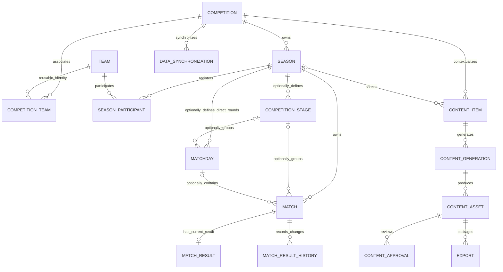

# Target Domain Model

## Aggregate boundary

`Competition` is an operator-owned aggregate root. It can contain multiple seasons and multiple independent content items. A content item references competition context; it is not itself a competition. Projects remain workflow/execution records during the transition.

| Concept | Responsibility and relationship |
| --- | --- |
| `Competition` | Stable local identity, name, sport and optional region/organizer metadata; owns seasons and source bindings. PD-ARCH-01A currently stores only UUID, name and timestamps. |
| `Season` | A competition's operator-provided label, such as `2026/27` or `2027`. A normalized label is unique within the competition; historical seasons are retained. PD-ARCH-01B stores UUID, competition FK, label and creation time. |
| `Team` | Reusable local club identity, independent of provider identifiers. PD-ARCH-01B stores name, optional region and timestamps in a global local catalogue. Exact normalized name+region duplicates are refused; similar names stay distinct. Editing this identity changes its display data wherever reused while preserving all associations. |
| `CompetitionTeam` | Membership of a global `Team` in one `Competition`, keyed by `(competition_id, team_id)`. It does not imply participation in every season. Removing the association retains the global team and is blocked while any season in that competition uses it. |
| `SeasonParticipant` | Membership of a competition-associated `Team` in one `Season`, keyed by `(season_id, team_id)`. Unlinking removes only this membership and retains both the global team and competition association. |
| `CompetitionStage` | Optional named grouping owned by a season. No synthetic “single phase” is created. Operators provide display order; the domain does not impose league/group/knockout rules. Implemented by 01C as `competition_stages`. |
| `Round` / `Matchday` | Optional named grouping owned either directly by a season or by one stage. Its name and order are operator supplied; it is not assumed numeric or consecutive. Implemented by `competition_rounds`, with separate uniqueness scopes for season-level and stage-level rounds. |
| `Match` | One stable scheduled event, always owned by a season. It may have no stage/round, a direct season round, a stage only, or a round inside a stage. Both teams must be registered season participants. Rescheduling changes the existing record and history, not its identity. Implemented by `competition_matches`. |
| `MatchResult` | Current optional score pair, persisted separately in one `match_results` row per match after additive migration `0006`. Migration `0006` backfills existing score pairs; migration `0008` relaxes the old state/score coupling while preserving paired, nonnegative integer values. State and score are independent manual fields; `null/null` means no score and `0/0` means a recorded 0–0. |
| `MatchResultHistory` | Append-only snapshots of creation, schedule/state changes, result recording and correction. Each snapshot retains the date, optional stage/round context, status and score pair. Implemented by `match_result_history`. |
| `Standing` | A sourced or calculated table snapshot for a defined competition/season/stage/as-of context. Store provenance and calculation version; never infer a table when required match data is incomplete. |
| `DataSource` | Local source/adapter registration and capabilities; provider-specific IDs live only in binding/reference records. |
| `DataSynchronization` | Explicit sync attempt, scope, timestamps, outcome and conflict summary. It is not a source of current truth; accepted imported values are projected into local operational records. |
| `ContentItem` | A reusable content brief/type bound to competition and optional season/stage/round. Stores selected local data references/snapshot policy, language and intent. |
| `ContentGeneration` | One generation attempt for a content item with prompt/editorial inputs, relevant data snapshot, outputs and status. |
| `ContentAsset` | Versioned image/copy/hashtag outputs attached to a generation/content item. |
| `ContentApproval` | Human decision against a specific current asset version and validation state. |
| `Export` | Existing accepted export artifact set for approved content; remains separate from competition and content intent. |

## Relationships (target)

This is a logical model, not a requirement to make every box a table. For example, a match result can be represented as a versioned match value if event history requirements remain clear. `Standing` can be materialized only when a stable snapshot/provenance requirement justifies it; otherwise calculate from complete local results.

## `Project` compatibility

Keep `Project` and its run/draft/carousel/approval/export chain as the historical workflow aggregate. In a later additive integration, add a nullable FK from new project workflows to the managed `Competition` (or introduce a content-item relation if multiple workflows per content item are required). Existing rows remain unlinked unless an operator-reviewed mapping proves identity. Preserve `competition_id`, `competition_name`, source/mode and selection snapshots for historical reproduction.

PD-ARCH-01A does not add a project FK because the existing create-project flow still selects provider catalogues and the new competition has no season/context data yet.

PD-ARCH-01B adds `competition_seasons`, `managed_teams` and `season_participants`; PD-ARCH-01C adds optional season calendar groups plus matches, current result pairs and append-only history. Migration `0007_competition_teams.sql` adds `competition_teams` and backfills the competition association for historical season participants without changing team identity or match references. The existing WI-1 `teams` table remains a run/verification identity map with separate semantics and is not reused or migrated.

## PD-ARCH-01C calendar rules

- A `competition_seasons` row is mandatory for every match. Stages and rounds are optional and no format-specific stage is inferred.
- A season may contain direct rounds and staged rounds together. A match may be direct, in a direct round, in a stage without a round, or in a stage round.
- Composite foreign keys and request validation require a stage and round to belong to the match's season and require a round's parent stage to equal the selected stage.
- Round identity is its season plus optional stage plus normalized operator label. Display order is stored separately; labels such as “Jornada 4”, “Semifinal de vuelta” and “Final” are all valid without numeric interpretation.
- Match participants must be registered in that same season. A participant with any scheduled match cannot be unlinked; this protects the calendar's referential integrity.
- Exact duplicate detection is scoped to the same season, home/away orientation, optional stage/round and non-null kickoff instant. Same opponents at another date, in another context, or with reversed home/away remain allowed.
- Scores are a separate current result pair. Manual operators may choose any status from any current status. Corrections append snapshots instead of overwriting history. An absent score remains `null`, never 0–0.
- All five statuses are independent of whether a score is present. A score is either `null/null` or two nonnegative integers; explicit `0/0` is a recorded 0–0. No-op updates do not append history.
