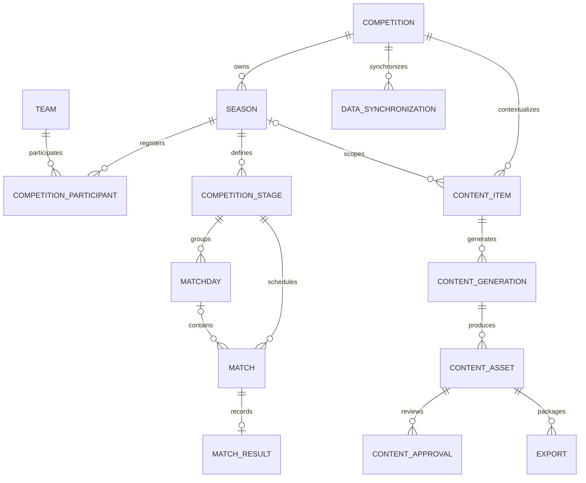

# Target Domain Model

## Aggregate boundary

`Competition` is an operator-owned aggregate root. It can contain multiple seasons and multiple independent content items. A content item references competition context; it is not itself a competition. Projects remain workflow/execution records during the transition.

| Concept | Responsibility and relationship |
| --- | --- |
| `Competition` | Stable local identity, name, sport and optional region/organizer metadata; owns seasons and source bindings. PD-ARCH-01A currently stores only UUID, name and timestamps. |
| `Season` | A competition's operator-provided label, such as `2026/27` or `2027`. A normalized label is unique within the competition; historical seasons are retained. PD-ARCH-01B stores UUID, competition FK, label and creation time. |
| `Team` | Reusable local club identity, independent of provider identifiers. PD-ARCH-01B stores name, optional region and timestamps in a global local catalogue. Exact normalized name+region duplicates are refused; similar names stay distinct. |
| `CompetitionParticipant` | Membership of a team in a season. PD-ARCH-01B uses the `(season_id, team_id)` composite primary key and a join timestamp; unlinking removes membership only and retains the team. |
| `CompetitionStage` | A stage under a season with a type and order: league, group, knockout, or special/custom. A season may have none, one, or many. |
| `Matchday` / `Round` | Optional round grouping within a stage; not every format has numbered matchdays. Use an explicit stable key and display order, not a required integer assumption. |
| `Match` | Scheduled event in a stage and optional round, with local participant references, kickoff/status and source-neutral identity. Rescheduled events retain identity/history. |
| `MatchResult` | Result state for a match, separate from schedule. A complete result requires a terminal result status and valid scores; unfinished/cancelled matches must not be represented as 0–0. |
| `Standing` | A sourced or calculated table snapshot for a defined competition/season/stage/as-of context. Store provenance and calculation version; never infer a table when required match data is incomplete. |
| `DataSource` | Local source/adapter registration and capabilities; provider-specific IDs live only in binding/reference records. |
| `DataSynchronization` | Explicit sync attempt, scope, timestamps, outcome and conflict summary. It is not a source of current truth; accepted imported values are projected into local operational records. |
| `ContentItem` | A reusable content brief/type bound to competition and optional season/stage/round. Stores selected local data references/snapshot policy, language and intent. |
| `ContentGeneration` | One generation attempt for a content item with prompt/editorial inputs, relevant data snapshot, outputs and status. |
| `ContentAsset` | Versioned image/copy/hashtag outputs attached to a generation/content item. |
| `ContentApproval` | Human decision against a specific current asset version and validation state. |
| `Export` | Existing accepted export artifact set for approved content; remains separate from competition and content intent. |

## Relationships (target)

This is a logical model, not a requirement to make every box a table. For example, a match result can be represented as a versioned match value if event history requirements remain clear. `Standing` can be materialized only when a stable snapshot/provenance requirement justifies it; otherwise calculate from complete local results.

## `Project` compatibility

Keep `Project` and its run/draft/carousel/approval/export chain as the historical workflow aggregate. In a later additive integration, add a nullable FK from new project workflows to the managed `Competition` (or introduce a content-item relation if multiple workflows per content item are required). Existing rows remain unlinked unless an operator-reviewed mapping proves identity. Preserve `competition_id`, `competition_name`, source/mode and selection snapshots for historical reproduction.

PD-ARCH-01A does not add a project FK because the existing create-project flow still selects provider catalogues and the new competition has no season/context data yet.

PD-ARCH-01B adds `competition_seasons`, `managed_teams` and `season_participants`; the existing WI-1 `teams` table remains a run/verification identity map with separate semantics and is not reused or migrated.
