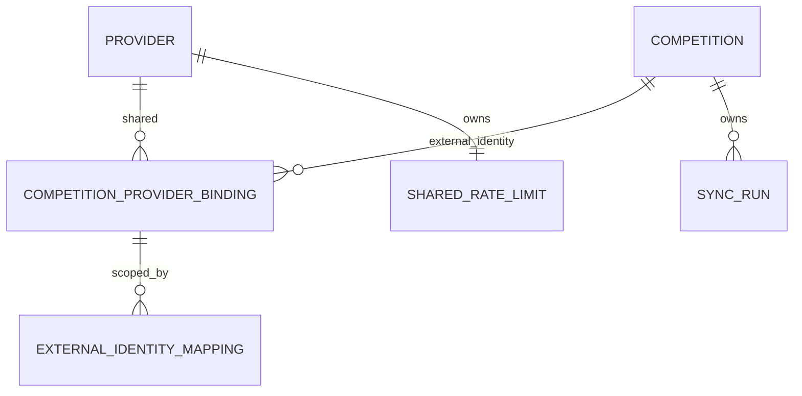

# PD-ARCH-01D — Architecture Decision Register

**Estado:** acuerdos de arquitectura para la propuesta; implementación pendiente de revisión/aprobación. No se han creado código, migraciones ni endpoints.

| ID | Decisión | Estado / consecuencia |
| --- | --- | --- |
| ADR-01D-01 | `Provider` es una configuración/instancia compartida y puede servir a N competiciones locales. | Acordado. No duplicar adapter, credenciales, configuración técnica, límites de consumo ni rate limiter por competición. |
| ADR-01D-02 | Cada `Competition` se vincula de forma independiente con la competición externa elegida mediante `CompetitionProviderBinding`. | Acordado. La identidad externa y estado operativo no se guardan en la configuración global del Provider. |
| ADR-01D-03 | La primera implementación permite como máximo un binding Provider activo por competición. | Acordado. No limitar cuántas competiciones puede usar el mismo Provider. |
| ADR-01D-04 | Identidades externas, selección/ajustes de sync, previews, conflictos, resoluciones e historial pertenecen al contexto de cada competición. | Acordado. Las mappings incluyen contexto de competición/binding, incluso cuando apuntan a un `Team` global reutilizado. |
| ADR-01D-05 | El rate limiting y presupuesto de solicitudes se comparten por Provider entre todas las competiciones vinculadas. | Acordado. La concurrencia agregada debe respetar una política, contador y adapter compartidos. |
| ADR-01D-06 | El modelo admite ampliar la relación a múltiples Providers por competición, pero esa capacidad no se activa en 01D inicial. | Acordado como requisito de extensibilidad. No se establece una política de precedencia todavía. |
| ADR-01D-07 | Datos ausentes, conflictos y decisiones de sync no cruzan automáticamente de una competición a otra. | Acordado. Errores, previews y resultados de sincronización mantienen `competition_id`; fallos/limitación de Provider pueden afectar disponibilidad compartida, pero no combinar cambios locales. |

## Cardinalidad

Para la primera implementación, de todos los bindings de una `Competition`, cero o uno está activo. Un `Provider` puede tener simultáneamente muchos bindings activos, cada uno a una competencia externa/local distinta.

## Extensión futura

Al permitir más de un binding activo por competición se necesitará una decisión explícita de precedencia/resolución. Este registro no propone ganador por proveedor, actualidad, confianza ni orden de configuración. Hasta que esa política se revise, las observaciones divergentes deben preservarse y mostrarse como conflicto, nunca combinarse silenciosamente.
