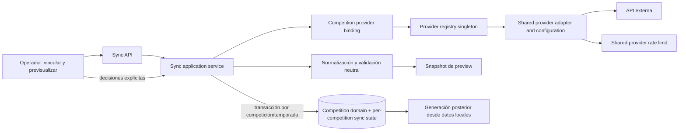
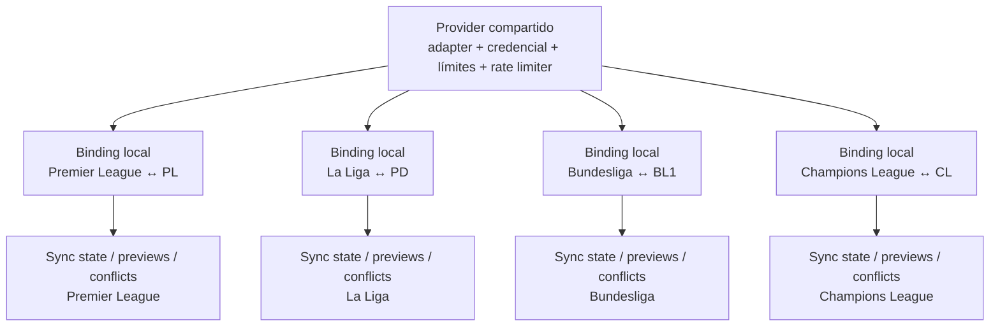
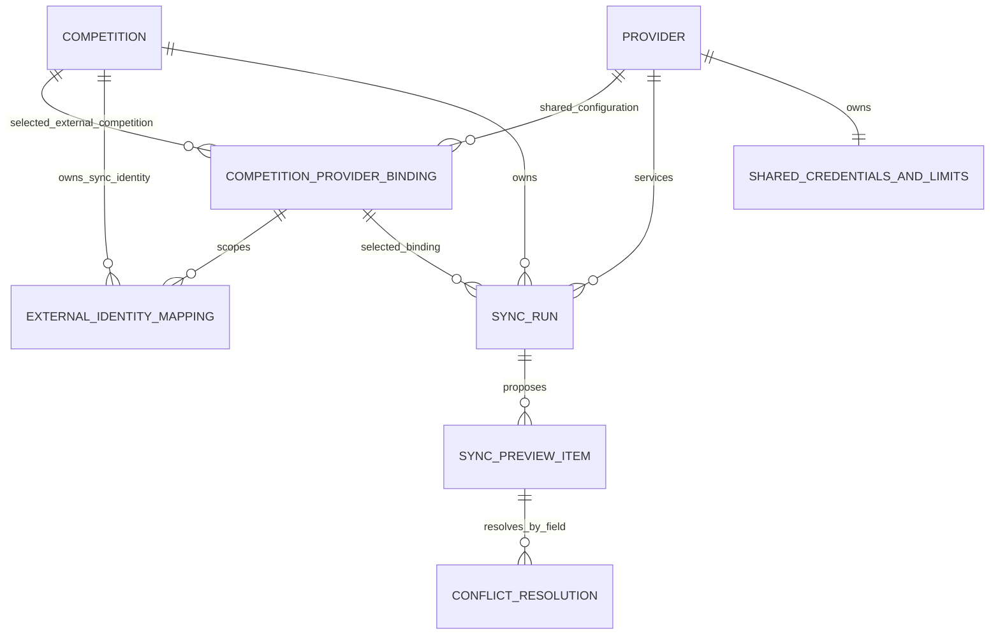

# PD-ARCH-01D — Hybrid Data Integration Proposal

**Estado:** propuesta para revisión del Product Owner.
**Alcance de esta iteración:** auditoría y diseño solamente; sin proveedor nuevo, migraciones ni cambios funcionales.

## 1. Diagnóstico de la arquitectura actual

### Dominio local administrado

PD-ARCH-01A–01C ya ofrece un agregado local, operativo y sin dependencia de una API:

- `competitions`: identidad local, nombre y timestamps.
- `competition_seasons`: etiqueta de temporada, única por competición.
- `managed_teams`: identidad global local de equipo.
- `competition_teams`: relación de un equipo con una competición.
- `season_participants`: inscripción de un equipo en una temporada.
- `competition_stages` y `competition_rounds`: agrupaciones opcionales.
- `competition_matches`: partido asociado siempre a temporada, con fase/ronda opcionales.
- `match_results`: marcador actual opcional; `null/null` significa que no existe y `0/0` es un resultado válido.
- `match_result_history`: historial de cambios de programación, estado y marcador.

Los contratos de `packages/contracts/src/http/competitions.ts` y `operations.ts` exponen entidades locales sin identidad de proveedor. Los repositorios SQLite y los servicios de administración/calendario validan pertenencia y relaciones localmente. Hoy no existe un enlace entre estos registros y los catálogos externos, ni procedencia por campo para sus valores.

### Integración deportiva existente

`apps/server/src/providers/sports` ya contiene un registro de fuentes, contratos de ingestión neutrales, validación compartida y adapters configurados. El catálogo de proveedores consulta competiciones, temporadas y fases externas. Estos IDs y `sourceId` pertenecen al flujo de catálogo/proyectos existente; no son las identidades de `Competition`, `Season`, `Team` o `Match` locales.

La importación manual existente persiste imports/versiones de selecciones para el flujo legacy. No actualiza `managed_teams`, `competition_matches` ni los resultados locales de PD-ARCH. No debe reutilizarse como si fuera una sincronización de entidades del nuevo dominio.

### Brecha

El dominio local ya es utilizable sin red y debe seguir siéndolo. Hace falta una capa de aplicación que convierta snapshots externos a modelos normalizados, relacione identidades de forma explícita, genere una vista previa inmutable y aplique cambios confirmados con procedencia y protección frente a overrides manuales.

## 2. Arquitectura propuesta



### Cardinalidad provider–competition

`Provider` representa una integración configurada una sola vez en el runtime, incluidos adapter, credenciales/secret references, límites y presupuesto de solicitudes. Un mismo Provider sirve **N competiciones locales**; sus credenciales, instancia de adapter y rate limiter se comparten entre todas ellas.

Cada `Competition` mantiene una `CompetitionProviderBinding` independiente que selecciona el Provider y su identidad externa para esa competición. Por ejemplo, un solo proveedor de fútbol puede vincularse a Premier League → `PL`, La Liga → `PD`, Bundesliga → `BL1` y Champions League → `CL`. La selección de la competición externa nunca se guarda como configuración global del Provider.

En la primera implementación una competición puede tener como máximo **un binding activo**, pero un Provider puede tener muchos bindings activos, uno por competición. El modelo de asociación será de cardinalidad N:M en potencia: conserva la posibilidad de añadir más bindings/provider a una competición en el futuro; no se implementa esa capacidad inicial ni se define precedencia entre proveedores. No imponer una restricción única sobre `provider_id` impediría que el Provider se reutilizara en otras competiciones.

Los sync runs, mappings externos, previews, conflictos, resoluciones e historial guardan `competition_id` y el binding/scope pertinente. Así, una operación sobre La Liga no cambia el estado de sincronización de Premier League, aunque ambas compartan el mismo servicio y presupuesto de solicitudes del Provider.



El ejemplo es ilustrativo de la cardinalidad: no selecciona ni recomienda un proveedor para producto. Todas las peticiones de esos bindings consumen el mismo límite agregado del Provider compartido.

### Componentes

| Componente | Responsabilidad | Decisión |
| --- | --- | --- |
| `Provider` / configuración de Provider | Define adapter, secretos/referencias de credenciales, límites de consumo y políticas técnicas compartidas. Una configuración/instancia por proveedor configurado, nunca una por competición. | Reutilizar configuración segura y registro de fuentes existentes; cualquier secreto permanece en configuración protegida, no en `Competition`. |
| `ProviderAdapter` | Lee recursos de un proveedor y los transforma a DTOs neutrales validados. No accede a SQLite ni decide qué se sobrescribe. | Sí, como puerto; sin nombres de API ni tipos externos en el dominio. |
| `ProviderRegistry` | Resuelve una fuente configurada por su clave local y expone capacidades declaradas. | Reutilizar y ampliar el registro actual si sus límites de catálogo encajan; no crear un segundo registro paralelo. |
| `CompetitionProviderBinding` | Asocia una competencia local con un Provider compartido y con la competición externa elegida. Contiene el contexto local de selección, no credenciales globales. | Sí; máximo un binding activo por competición en la primera implementación, sin limitar cuántas competiciones usan el mismo Provider. |
| `CompetitionSyncConfiguration` | Preferencias operativas locales: binding activo, recursos/scopes usados en una acción y defaults de revisión. Nunca contiene credenciales, límites técnicos ni el contador compartido. | Responsabilidad lógica de `Competition`/binding; decidir si requiere persistencia propia cuando se definan necesidades reales. No implica sincronización automática. |
| `SyncOrchestrator` | Comprueba capacidades/vinculaciones, ejecuta lectura explícita, normaliza, compara y construye preview. | Sí, servicio de aplicación; no se activa desde creación/generación de contenido. |
| `ExternalIdentityMapping` | Une una entidad local estable con una referencia opaca externa y su contexto. | Sí, persistencia aditiva separada; una entidad local puede mapearse a varios proveedores. |
| `SyncPreview` | Snapshot de las propuestas, diferencias, conflictos y decisiones necesarias. | Sí; la confirmación debe usar el snapshot que vio el operador, no volver a leer la API. |
| `ConflictResolution` | Decisión explícita por campo/entidad: conservar valor local o aceptar el valor entrante. | No requiere un servicio independiente al inicio; forma parte de la aplicación de un preview. |
| `DataSynchronization` | Registro durable del intento, alcance, resultado y fallos sanitizados. | Sí; permite idempotencia y trazabilidad sin ser fuente operativa de los valores. |

### Relación con el código actual

La integración propuesta se implementaría dentro de la frontera `competitions`, con puertos de aplicación hacia `providers/sports/ingestion`. Los adapters actuales seguirían sirviendo al catálogo legacy. Un adapter solo podría ser usado para sync del dominio administrado si declara y entrega capacidades/snapshots adecuados; que hoy soporte `listCompetitions`, `listSeasons` o `fetchSelection` no significa que ya soporte sincronización de partidos locales.

El adapter y su configuración técnica viven en el registro compartido, con ciclo de vida de aplicación/proveedor. Las peticiones de sincronización conservan su contexto local de competición/binding, pero usan la misma instancia y el mismo request budget del proveedor. La concurrencia agregada de todas las competiciones vinculadas debe quedar dentro de los límites configurados para ese Provider; no se crea un presupuesto independiente por competencia ni se duplican credenciales.

Los servicios de generación continuarían leyendo exclusivamente el estado local elegido y congelado. No se agrega consulta externa al crear proyecto, generar contenido, abrir una competición o cargar una temporada.

## 3. Modos de administración

Propuesta: guardar `administrationMode` en `Competition`, con `manual | provider | hybrid`, y asignar `manual` a todas las competiciones existentes mediante valor por defecto de aplicación y migración aditiva revisada.

- **manual:** administración exclusivamente local, sin vinculación ni sincronización de proveedores; el comportamiento de las competiciones actuales se conserva.
- **provider:** una fuente externa vinculada es la fuente preferente para proponer datos; se permiten correcciones manuales, protegidas como overrides. Importar sigue requiriendo preview y confirmación.
- **hybrid:** administración combinada de datos manuales e importados; el operador puede crear/editar localmente y sincronizar campos seleccionados, con la misma protección de overrides.

Los tres modos mantienen los mismos registros operativos locales. El modo no certifica que una fuente sea oficial o verificada, no indica publicación permitida y no sustituye la procedencia por entidad/campo. Ningún modo genera llamadas al proveedor al abrir pantallas ni durante generación de contenido.

## 4. Modelo de persistencia candidato

No aplicar todavía. El detalle de columnas, índices, claves y migraciones se decidiría tras aprobar etapas y revisar volumen/retención.

### Identidades externas

`external_identity_mappings` propuesta:

- clave interna estable;
- `competition_id` obligatorio para mantener identidad, procedencia y resolución dentro de la competición local;
- `competition_provider_binding_id` (o clave equivalente) que determina el Provider compartido y la competición externa enlazada;
- `provider_key` derivado de la configuración compartida, no duplicado como credencial/configuración por competición;
- `entity_type`: `competition | season | team | match`;
- `external_id` opaco, guardado como texto sin asumir UUID o formato;
- `external_scope` opcional para IDs cuya unicidad solo exista bajo una competición/temporada externa;
- `local_entity_id` y contexto local requerido según tipo (`competition_id` se conserva también para Team global);
- vínculo activo, fechas de creación/última observación y timestamps.

Restricciones de unicidad candidatas: `(competition_provider_binding_id, entity_type, external_scope, external_id)` no puede identificar dos entidades locales en esa competición; una identidad local tampoco puede tener dos mappings ambiguos para el mismo tipo/binding/contexto. El mismo Provider y su external ID pueden aparecer en mappings de competiciones locales distintas sin colisionar. Las reglas sobre nulabilidad de `external_scope` deben representarse con índices SQLite explícitos, no depender de la semántica de NULL en una clave UNIQUE.

Los mappings de temporada, equipo y partido deben quedar anclados a su padre local. Un partido externo no puede apuntar a una temporada local diferente a la del partido. Los vínculos no se infieren por nombre ni se fusionan por semejanza.

El modelo incluye `providers` (catálogo/registro de configuración compartida, posiblemente sin tabla de dominio) y `competition_provider_bindings` entre `Competition` y un Provider. Un Provider puede asociarse con N competiciones y cada binding guarda una identidad externa independiente de competición. En el primer slice se permite un solo binding activo por competición, pero no se limita la cantidad de competiciones vinculadas al mismo Provider. Las credenciales/secret references, la configuración técnica y los límites se resuelven una sola vez en el Provider/registro; la selección externa y la configuración operativa de sync pertenecen al binding/Competition.

La configuración operativa de sync es de ámbito de competición (y referencia el binding activo). Puede recordar recursos o scopes seleccionados para facilitar acciones explícitas; no representa programación automática. No replica secretos ni configuración técnica del Provider.

`external_identity_mappings` siempre tiene contexto `competition_id` y una referencia al binding/provider usados. Esto permite la misma entidad global `Team` o una identidad externa compartida por varios torneos sin mezclar historiales y decisiones de sincronización. La unicidad y resolución se aplican dentro de la competición/binding; las identidades históricas se conservan. La estructura debe admitir en el futuro varios bindings activos por competición, sin activarlos todavía ni decidir una política de precedencia.

El modelo de mappings no debe limitar el número de identidades externas por entidad local: a futuro una competición podrá conservar referencias de varios proveedores y esas referencias servirán para comparar observaciones o cambiar la fuente. Los mappings históricos no se eliminan al cambiar el binding activo.



Invariantes iniciales: `count(active CompetitionProviderBinding for Competition) <= 1`; no existe invariante `count(CompetitionProviderBinding for Provider) <= 1`. Las credenciales, configuración técnica y cuota de solicitudes se comparten por Provider; las preferencias de sync, binding, identidades externas, previews, conflictos e historiales llevan `competition_id`.

### Observaciones y estado por campo

Para proteger cambios manuales sin convertir al proveedor en fuente de verdad, se propone:

- `sync_runs`: provider, competencia y alcance local, temporada(s), recursos, estado, idempotency key, inicio/fin y resumen.
- `sync_run_items`: entidad propuesta, operación (`create`, `update`, `unchanged`, `conflict`, `skip`), estado y error sanitizado.
- `sync_field_observations`: valor neutral recibido por campo, referencia externa opaca, hora observada y hash; evitar persistir payload bruto/secretos.
- `managed_field_state` (o estructura equivalente): entidad/campo, último baseline importado, origen actual, `manual_override`, observación de origen y actualización local.
- `sync_conflict_resolutions`: campo/entidad, valores anterior/entrante resumidos, decisión, hora y referencia al intento.

La forma de mantener `managed_field_state` debe validarse con los formatos de datos seleccionados. Alternativa más simple: snapshots de proveedor versionados más override explícito en las entidades. Se recomienda empezar con estado por campo únicamente para campos sincronizados y con un conjunto acotado definido por adapter.

Valores deportivos operativos siguen en las tablas existentes. La capa de provenance explica cómo llegó cada valor, no los reemplaza por un JSON completo ni cambia `MatchResultHistory`.

## 5. Contratos neutrales propuestos

Esbozo TypeScript para discusión, no código aprobado:

```ts
type ExternalEntityKind = 'competition' | 'season' | 'team' | 'match';
type SyncResource = 'competition' | 'seasons' | 'teams' | 'participants' | 'stages' | 'rounds' | 'matches' | 'results';

interface ExternalRef {
  readonly providerKey: string;
  readonly kind: ExternalEntityKind;
  readonly externalId: string;
  readonly externalScope: string | null;
}

interface ProviderSnapshot<T> {
  readonly providerKey: string;
  readonly fetchedAt: string;
  readonly competition: ExternalRef;
  readonly season: ExternalRef | null;
  readonly records: readonly T[];
  readonly warnings: readonly NeutralProviderWarning[];
}

interface ProviderAdapter {
  readonly providerKey: string;
  readonly capabilities: ReadonlySet<SyncResource>;
  previewSnapshot(input: {
    readonly competitionRef: ExternalRef;
    readonly seasonRef: ExternalRef | null;
    readonly resources: readonly SyncResource[];
    readonly signal: AbortSignal;
  }): Promise<ProviderSnapshot<NormalizedSportsRecord>>;
}

interface SyncPreviewRequest {
  readonly localCompetitionId: string;
  /** Uses that competition's active provider binding; never creates a provider instance. */
  readonly bindingId: string;
  readonly localSeasonId: string | null;
  readonly resources: readonly SyncResource[];
}

interface SyncPreviewSummary {
  readonly previewId: string;
  readonly expiresAt: string;
  readonly counts: { readonly new: number; readonly changed: number; readonly unchanged: number; readonly conflicts: number; readonly invalid: number };
  readonly items: readonly SyncPreviewItem[];
}

interface SyncPreviewItem {
  readonly entity: ExternalEntityKind;
  readonly externalRef: ExternalRef;
  readonly proposedAction: 'create' | 'update' | 'unchanged' | 'conflict' | 'skip';
  readonly fieldChanges: readonly {
    readonly field: string;
    readonly currentValue: unknown;
    readonly incomingValue: unknown;
    readonly protection: 'none' | 'manual_override' | 'local_changed_since_import';
  }[];
  readonly issues: readonly NeutralProviderWarning[];
}
```

Adapter outputs use only canonical local representations: stable external references, display names, ISO date/time with known timezone semantics, optional paired integer scores, and optional grouping references. The adapter cannot write data, choose local IDs, declare imported values verified, or decide conflicts. Unknown provider fields are discarded; no raw response or secrets are included in prompts, client DTOs, or logs.

### API flow candidate

Routes are suggestions for contract design, not authorization to implement:

1. Read available configured Providers/capabilities from the shared registry; do not create a provider copy for a competition.
2. Select one Provider and explicitly create a binding for this competition with its external competition identity. Other local competitions may bind independently to the same Provider and different external IDs.
3. `POST /competitions/{competitionId}/sync-previews` uses that competition's active binding ID, bound external season, selected resources and scope; it does not accept per-competition credentials or a new provider instance.
4. `GET /competitions/{competitionId}/sync-previews/{previewId}` to reopen the exact preview.
5. `POST /competitions/{competitionId}/sync-previews/{previewId}/apply` with explicit conflict decisions and an idempotency key.
6. Read that competition's `sync_runs` history and per-item outcomes.

The local competition and season IDs remain the only identifiers used by downstream generation. Existing API response shapes need not expose provider refs or paths by default; a creator-facing summary can expose provider display label and last sync timestamp while detailed provenance remains privileged/internal to the local operator.

## 6. Synchronization, conflict and consistency strategy

1. **Select:** operator chooses an available shared Provider, links a local competition to its external competition, then chooses a season, resource subset and explicit action time. Further competitions reuse that same configured Provider and select their own external competition identity. No implicit provider call occurs on navigation or generation.
2. **Fetch and normalize:** the singleton adapter reads selected resources with existing deadlines, retry/egress controls and one shared provider-wide rate budget. All competitions using the Provider consume that common budget, including concurrent requests. Shared validators reject malformed records and normalize into neutral DTOs. Network calls happen before opening a DB transaction.
3. **Match identities:** use existing external mappings first. Unmapped records become candidates. Names, region, date or score can flag possible duplicates but never auto-merge or silently establish identity. Operator resolves uncertain mapping in preview.
4. **Compare fields:** compare incoming value, current local value and last applied provider baseline. A field is safe to update only if it has no manual override and current value still matches the last imported baseline. Otherwise show a conflict and retain the local value by default.
5. **Preview:** persist a finite normalized snapshot and per-item diff for **30 minutes**. Counts distinguish new, safe update, unchanged, conflict, invalid and skipped. Each manually protected value is called out; preview cannot claim that imported data is verified. Store local versions/fingerprints for every entity and field considered by the preview.
6. **Confirm:** operator chooses apply/skip per conflict and each field-level conflict resolution is audited. Apply references `previewId`, never fetches again. Before applying, compare current local versions/fingerprints with those captured at preview time. If any relevant value changed meanwhile, reject the stale apply, retain every local value and require a fresh preview; do not silently recompute a proposal the operator did not see. Expired previews also require a new fetch/preview. Repeated confirmation with the same idempotency key returns the previous result, without duplicate rows/history.
7. **Persist:** use an SQLite transaction for each selected local season scope: upsert mappings, local entities, memberships, results, provenance and history together. Validate same-season participants and stage/round relationships before commit. A database failure rolls that scope back. Do not hold a transaction over provider I/O.
8. **Partial outcomes:** initial release should restrict a preview to one local season per apply. If multiple independent scopes are later supported, apply each in a bounded, explicit transaction and report committed scopes plus failed scopes; never claim all-or-nothing across independent transactions. Within one season apply is atomic.
9. **Absence/deletion:** records missing from a provider response are not deleted or detached. If and only if the adapter confirms a complete response for the selected scope, show absence as a non-destructive warning (“no aparece en esta sincronización”) and record it as a source observation. A partial, paginated-incomplete or failed response cannot imply absence. Any archive/unlink proposal requires a later explicit product rule.
10. **Traceability:** in each competition's own sync history persist binding/provider reference, selected scope, fetched/observed/applied timestamps, normalized snapshot hash, counts, per-item outcomes and safe failure class. Shared provider metrics/rate-limit counters remain at Provider scope; do not log credentials, raw provider bodies, query tokens or filesystem paths.

### Manual overrides

- A manual edit marks the affected field as overridden and appends existing domain history where available; sync continues to update unrelated unprotected fields.
- If current local data differs from the last imported baseline but no override marker exists, treat it as a conflict. This defensive comparison catches direct/legacy edits.
- A conflict defaults to retain-local. Accepting incoming clears the override only for that field and appends an audit/history event with the prior and accepted values.
- The resolution records the operator decision, local fingerprint observed at preview, fingerprint/value accepted, preview/run reference and timestamp. The apply-time fingerprint guard prevents a valid decision from overwriting a newer concurrent local edit.
- A manual-only new team/match may coexist with the linked provider data. It has no mapping until explicitly matched; do not infer an external identity from matching names.
- For scores, reuse `match_results` and append `match_result_history`; history records both prior and resulting status/score. Preserve `null/null` as “no result” and `0/0` as an explicit 0–0 result across adapter normalization, previews, conflict decisions, persistence and reload. Never use truthiness for zero; pass the existing nullable paired-score rules.

## 7. Architectural choices and tradeoffs

| Choice | Benefit | Cost / alternative |
| --- | --- | --- |
| Keep local tables authoritative and import into them | Offline operation, stable generation input, continued manual workflows. | Requires mapping/provenance and merge logic. Alternative—read live provider at generation—violates local-first and explicit-sync requirements. |
| Add source-neutral mapping rows rather than provider columns on each entity | Several providers per local record; no provider schema leakage; safe re-link/reconciliation. | More joins and uniqueness/context design. A single external ID column is simpler but blocks multiple providers and scope collisions. |
| Persist preview snapshot before confirmation | Review and apply refer to identical data; retries are reproducible and do not spend a second provider request. | Storage/expiry cleanup and privacy policy required. Stateless preview risks provider changes between review and apply. |
| Recheck local fingerprints at apply time | Concurrent/manual edits after preview cannot be overwritten by an old confirmation. | Stale previews need a new review cycle; compare canonical per-field values as well as entity versions. |
| One active provider binding per competition at first; Provider is shared across competitions | Keeps each competition's write source unambiguous while avoiding duplicate credentials, adapters and rate budgets. | Switching a competition binding needs an explicit later workflow; active multi-provider sync remains a future extension without a precedence rule. |
| Track override/provenance at field level | Protects only edited fields; other provider updates can continue. | More metadata and conflict UI. Entity-level lock is simpler but prevents useful partial sync. |
| Atomic apply for one season scope | Clear consistency for team membership, matches, scores and history. | Large imports may increase transaction duration; use bounded scope and chunk only with explicit partial semantics. |
| No provider deletion inference | Prevents lost history and mistaken removals. | Operators may need explicit archival later. |
| No fuzzy auto-merge | Prevents same-name clubs or competition identities being merged incorrectly. | More manual mapping for ambiguous records. |
| Preserve existing source registry; bridge by capabilities | Reuses egress/security/retry and existing adapters. | Existing catalogue ports are not necessarily suitable for full local sync; capabilities/contracts may need extension or a separate read-only adapter port. |

## 8. Risks and open questions

1. **Provider capability gap:** current adapters serve catalogue/selection flows; inspect their stable match, participant and result coverage before promising any full-sync capability.
2. **Multiple-provider precedence:** future support for linking/syncing more than one Provider for one competition introduces conflicting values, duplicated fixtures and competing absence signals. Initial sync permits one active binding per competition, while one Provider can serve many competitions simultaneously. No precedence policy is selected here; before enabling several active providers on one competition, decide whether precedence is field-specific, user-selected per operation, or follows another explicit rule. Until then, competing observations must be preserved and surfaced as conflicts, never auto-ranked.
3. **Source switching:** define whether changing the one active binding requires an explicit rebind and fresh preview for existing entities. Historical mappings should remain; no silent relink or remapping by names. A source switch must not create another copy of provider credentials or reset the Provider-wide rate budget.
4. **External ID scope:** adapter contract must declare whether IDs are provider-global or parent-scoped without leaking provider-specific assumptions.
5. **Time semantics:** provider kickoffs may be local wall time, UTC or missing timezone; normalized instants must not be fabricated.
6. **Deletion/withdrawal:** there is no approved behavior for entities removed from a provider schedule; proposal defaults to retain and flag absence.
7. **Historical mapping:** existing manual imports, legacy `teams` and projects must not be auto-mapped to managed entities. Any migration/link requires operator review and stable evidence.
8. **History retention:** decide retention for raw normalized preview snapshots and sync runs. Do not store raw provider payload by default.
9. **Verification meaning:** an imported provider value is not automatically verified/publishable. Define any future verification evidence separately from successful ingestion.
10. **Review effort:** previews with many fixtures need filtering/grouping and field-level conflict controls while still showing every planned change before apply.

### Product Owner decisions incorporated

- Modes: `manual` is local-only; `provider` means external source preferred with manual corrections allowed; `hybrid` combines manually authored and imported data.
- One shared Provider can be used by N local competitions, each with an independent external competition binding and sync history. The first implementation allows at most one active Provider binding per competition.
- Credenciales, configuración técnica y rate limits son compartidos por Provider; las sincronizaciones concurrentes entre sus competiciones usan el mismo limiter. Bindings, identidades externas, previews, conflictos e historiales pertenecen a su Competition.
- The model can represent multiple Providers for one Competition in the future; this proposal does not implement that cardinality or select a precedence policy.
- Previews expire after 30 minutes and are guarded by local versions/fingerprints at apply time.
- A confirmed-complete provider response may warn about absent records; it never deletes or detaches them.
- Conflicts resolve explicitly per field, are audited, and default to preserving local values.
- Scores retain the distinction between `null/null` and `0/0`.

Open design work remains for retention duration of completed sync/audit history, exact field sets by capability, provider timezone semantics, source switching and a future multi-provider precedence policy.

## 9. Incremental implementation plan

Do not implement these stages until the architecture proposal and each relevant checkpoint are approved.

| Slice | Scope | Acceptance criteria |
| --- | --- | --- |
| **01D-A — Provider capability and identity foundation** | Extend neutral adapter/registry contracts for capabilities and external refs; configure one shared Provider instance/budget; add per-competition binding and identity mappings; expose available configured Providers and explicit link/unlink. No entity sync yet. | Existing manual competition works unchanged; one Provider binds to at least two competitions with independent external competition IDs; each competition has at most one active binding; provider credentials/configuration/limiter are not duplicated per competition; the model permits future additional bindings without enabling them; all changes are additive. |
| **01D-B — Read, normalize and preview** | Fetch one explicitly selected competition-season/resource scope through that competition's binding; normalize teams, participants, optional stages/rounds, matches and paired results; persist competition-scoped expiring preview and diff only. | No local sports entity changes before apply; preview has new/changed/unchanged/conflict/invalid counts; invalid dates/scores/context are actionable; repeat preview is deterministic for the captured snapshot; separate competitions have independent previews even when sharing one Provider. |
| **01D-C — Confirm and safely apply** | Explicit per-field decisions; idempotent apply; per-season SQLite transaction; update mappings, operational data, field provenance and histories; sync run results. | Manual overrides never silently change; conflicts default to local; failed transactions leave no partial season mutation; retries return the first result; repeated schedules/results do not duplicate entities/history. |
| **01D-D — Operator experience and resilience** | Competition source status, last sync, preview review/resolution, sync history and safe retry UX; enforce bounded provider-wide resilience and shared rate limiting across competitions; display per-competition outcomes. | No silent/background sync; two competitions sharing a Provider cannot exceed its aggregate request policy; errors and partial outcomes are scoped/reported correctly; keyboard/mobile review is usable; existing calendar and project workflows remain functional. |

### Verification plan for implementation slices

- Unit tests: mapping key/scoping, normalization, source-neutrality, field merge rules and conflict decisions; singleton Provider/adapter registration and shared provider-budget accounting.
- Persistence tests on temporary SQLite DBs: migrations, uniqueness, FK integrity, transaction rollback, no deletes, idempotent apply and history consistency.
- Contract tests: preview/apply schemas, provider capability response, explicit scope validation and sanitized failures.
- Integration tests with synthetic adapters: repeated preview/apply, manual override preservation, duplicate candidates, one provider failure, stale/expired preview, and two competitions with distinct external competition IDs reusing one Provider instance and shared rate limiter.
- Typecheck, affected lint, unit/contract/integration tests, build and `git diff --check`; no E2E or browser automation under PD-UI-21.

## 10. Review boundary

This proposal deliberately does not select a commercial or open sports API, define a final SQLite schema, create migrations, add routes, or alter PD-ARCH-01C. After Product Owner feedback, the architecture and roadmap should be amended and a separate implementation slice authorized.
