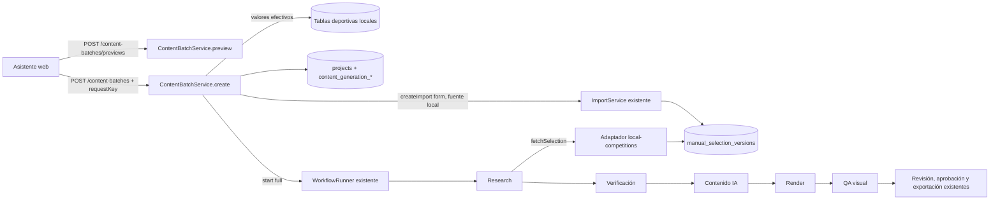

# PD-ARCH-01E — Informe de implementación (etapa 01E-A)

## Estado

**PD-ARCH-01E-A aceptada por el Product Owner el 2026-11-05** y cerrada en `work/PD-ARCH-01E`, creada desde el
checkpoint de PD-ARCH-01D-D `698b90dec4f4cd0c18a022f6cf778dbab2bdd4fd`. PD-ARCH-01E-B (calendario, próximos
partidos y previa) **permanece pendiente**; su propuesta está en
[pd-arch-01e-b-architecture-assessment.md](./pd-arch-01e-b-architecture-assessment.md). La evaluación previa y las
decisiones del PO están en [pd-arch-01e-architecture-assessment.md](./pd-arch-01e-architecture-assessment.md).

## Decisiones del Product Owner aplicadas

1. PD-ARCH-01E se divide en 01E-A (integración con el motor existente y generación real por lotes) y 01E-B (ampliación
   versionada del motor).
2. Sin nuevos `SlideType` ni cambios en las reglas estructurales del motor de contenido.
3. La fuente local declara `MANUAL_DATA`.
4. Cada lote confirmado se congela como una importación de formulario de la fuente local (una versión por pieza), porque
   el motor exige que toda evidencia `MANUAL_DATA` cite una versión de importación (FK de `retrievals` y
   `observations`). No se reconstruye ninguna tabla existente.

## Arquitectura utilizada

- **Adaptador `local-competitions`** (`apps/server/src/providers/sports/adapters/local-competitions/`): implementa el
  puerto de ingesta. No es fuente de catálogo (lista vacía), de modo que el flujo heredado de creación nunca la ofrece.
  `fetchSelection` lee la versión congelada de la pieza y construye el snapshot con `snapshotOfVersion` del adaptador
  manual. No usa egress ni consulta previews o snapshots de proveedor.
- **Servicio de lotes** (`apps/server/src/modules/projects/content-batches/`): valida el contexto, planifica, congela,
  crea proyectos y arranca ejecuciones con el `WorkflowRunner` del módulo de proyectos.
- **Importaciones** (`modules/imports`): `createImport` acepta una fuente destino explícita para los lotes;
  `manualSource()` excluye la fuente local, así las importaciones del operador nunca caen en ella.
- **Catálogo y atestación (AD-38)**: si un enlace de `config/catalogue.json` vincula **solo** la competición local, el
  proyecto usa el ID del enlace; si el enlace vincula además otra fuente no se usa, porque la verificación la
  consultaría durante la generación.

No se creó un motor paralelo: research, verificación, contenido, renderizado, QA visual, revisión, aprobación y
exportación son los existentes, sin cambios.

## Integración con proyectos

Cada pieza lista es un proyecto normal de la fuente «Datos deportivos locales» (`MANUAL_DATA`):

- `stageLabel` = jornada, con su fase como prefijo (`Fase - Jornada`); `matchday = null`;
  `standingsExpected = not_expected`.
- El título de una pieza por partido añade el encuentro: `Liga Local 2026/27 · Jornada 12 · Club Alfa - Club Beta`.
- `Project.sportsContext` expone lote, pieza, tipo, competición, temporada, fase, jornada y partidos.
- El proyecto aparece en el listado de proyectos y se revisa, aprueba y exporta desde su página habitual.

## Integración con plantillas

No hay selección libre de plantilla en la plataforma: cada diapositiva usa la versión vigente de su tipo. La vista
previa muestra las plantillas compatibles con el carrusel de resultados sin clasificación (`cover`, `match_result`,
`closing`). Los requisitos de datos se validan antes de confirmar con la misma función que congela la selección
(`localResultIneligibility`): partido `finished`, ambos marcadores, fecha y nombres válidos para la plantilla. Nada se
completa con valores ficticios. La exportación conserva los formatos existentes.

## Tipos de contenido implementados

| Tipo | Implementación |
| --- | --- |
| Resultados de jornada (`round_results`) | Un carrusel con los partidos finalizados seleccionados. |
| Resultado individual (`match_result`) | Una pieza por partido finalizado seleccionado (el carrusel existente con un partido). |
| Resumen de jornada | **No implementado**: con el motor actual sería el mismo carrusel con otro nombre. Ver 01E-B. |
| Calendario, próximos partidos, previa | **01E-B**. |

`null/null` nunca se muestra como 0-0 y una fecha pasada nunca convierte un partido en disputado.

## Contratos

Zod (`packages/contracts/src/http/content-batches.ts`) y OpenAPI (`contracts/http-api.openapi.yaml`):

| Operación | Método y ruta | Respuesta |
| --- | --- | --- |
| `previewContentBatch` | `POST /api/v1/content-batches/previews` | `200 ContentBatchPreview` (sin escrituras) |
| `createContentBatch` | `POST /api/v1/content-batches` | `202 ContentBatch` |
| `getContentBatch` | `GET /api/v1/content-batches/{batchId}` | `200 ContentBatch` |

Componentes nuevos: `ContentBatchSelection`, `ContentBatchCreate`, `ContentBatchContext`, `ContentBatchMatch`,
`ContentPiecePlan`, `ContentBatchPreview`, `ContentBatchItem`, `ContentBatch` y `ProjectSportsContext`.
`Project` agrega `sportsContext` (nullable). Códigos de problema nuevos: `CONTENT_BATCH_NOT_GENERATABLE` (409) y
`REQUEST_KEY_REUSED` (409). Selección separada en: contexto (competición, temporada, fase, jornada), partidos
(máx. 32, que acota a 64 equipos por pieza) y tipos. Ninguna estructura del proveedor aparece en estos contratos.

## Persistencia

Migración aditiva `0017_content_generation_batches.sql`:

- `content_generation_batches`: clave de idempotencia única, hash de la selección, contexto (FK a competición y
  temporada; fase y jornada como referencias blandas con etiquetas congeladas), etiqueta de selección, idioma e
  importación congelada (FK a `imports`).
- `content_generation_items`: posición, tipo, título, proyecto (único), ejecución inicial, versión congelada (única) o
  motivo de omisión; `CHECK` de coherencia entre ellos.
- `content_generation_item_matches`: partidos de cada pieza en orden.

Migración `0018_content_generation_batches_reconcile.sql`: recrea las tres tablas anteriores con su definición final
(idéntica a `0017`). Existe porque el servidor de desarrollo del PO, en modo `--watch`, aplicó a la base real un
borrador temprano de `0017` sin `import_id` ni `selection_version_id`; después se completó `0017` y el runner no
reaplica versiones registradas, por lo que `createContentBatch` respondía 500 (`no such column`). Una guarda aborta la
migración completa, sin cambios, si esas tablas contienen alguna fila (en la base del PO estaban vacías). En bases nuevas
recrea tablas vacías recién creadas.

Migración `0019_operator_validated_approvals.sql`: columna aditiva `manual_approvals.origin` (ver PD-ARCH-01E-PD-01).

No se modifica ni reescribe ninguna otra tabla ni fila existente. La configuración agrega la fuente `local`
(`adapter: local-competitions`) en `config/app.config.json`, `dev.config.json`, `dev-live.config.json` y
`live.config.json`.

## Idempotencia e integridad

- **Doble clic / reintentos:** el cliente genera un `requestKey` por selección confirmada y lo reutiliza en reintentos.
  En `BEGIN IMMEDIATE`, una clave existente con el mismo hash devuelve el mismo lote sin crear nada; con otro hash
  responde `REQUEST_KEY_REUSED`. La UI desactiva el botón mientras envía.
- **Atomicidad:** lote, importación congelada, proyectos, piezas y ejecuciones se registran en una sola transacción.
  Las ejecuciones corren después, de forma asíncrona e independiente: **no se afirma atomicidad entre renderizados**.
  Una pieza fallida conserva su proyecto y puede ejecutarse de nuevo desde su página.
- **Estado real:** cada pieza refleja la última ejecución de su proyecto; el lote es `in_progress` mientras haya
  pendientes y luego `completed`, `partial` o `failed`. Si un archivo original se escribe y la transacción se revierte,
  queda un original huérfano sin registro, como en el flujo de importación existente.
- **Reproducibilidad:** volver a ejecutar un proyecto lee el mismo snapshot congelado; una corrección posterior se
  incorpora confirmando un nuevo lote.

## Interfaz

- **Asistente** `/projects/generate` (acceso desde «Tus proyectos» y desde el detalle de cada jornada en Competiciones,
  con preselección): 1) contexto deportivo con opciones válidas en cascada (jornadas sin partidos deshabilitadas, filtro
  por fase), 2) tipo de contenido, 3) partidos (uno, varios o todos), 4) revisión con plantillas, piezas, motivos de
  omisión y cantidades calculadas por el servidor. «Anterior» conserva las selecciones. Nada se genera hasta
  «Confirmar y generar».
- **Resultado** `/projects/batches/:batchId`: totales solicitados, generados, fallidos, omitidos y pendientes; estado
  e identificador de cada pieza; enlace a cada proyecto; sondeo con el intervalo existente mientras haya pendientes.
- **Proyecto:** sección «Contexto deportivo» con enlaces a la competición y al lote.
- Componentes y tokens del design system de 01D-D: acción principal dorada, secundaria sólida, estados de carga y
  error con `LoadingState` y `ErrorBanner`, `fieldset`/`legend`, `aria-current="step"` y regiones `aria-live`.

## Pruebas

| Ámbito | Archivo | Cobertura |
| --- | --- | --- |
| Dominio (unitarias) | `content-batches/plan.test.ts` | Elegibilidad (0-0 frente a `null/null`, fecha pasada, estados no finalizados, fecha y nombres), plan por tipo, conteos reales, contexto no representable, etiqueta y hash. |
| Fuente de importaciones | `imports/local-source.test.ts` | Las importaciones del operador nunca usan la fuente local. |
| Integración end-to-end | `test/integration/delivery/local-content-batches.test.ts` | Preview sin escrituras ni egress; 404 de partido, fase y jornada ajenos; borradores reales y correctamente acotados para subconjuntos distintos; contexto deportivo; reintento y doble envío concurrente sin duplicados; clave reutilizada; override manual protegido; congelado y reproducibilidad; nada que generar; fallo parcial; sin fuente local; trazabilidad a la versión congelada; catálogo sin contaminar; aprobación manual, aprobación final y exportación de una competición atestada (AD-38). |
| Persistencia | `platform/db/migrations.int.test.ts`, `schema.int.test.ts` | 0016 → 0017 sin alterar filas; tablas, columnas, FK, índices y escaneo R-233. |
| Contrato | `test/contract/*` | OpenAPI/Zod, operaciones servidas reales (preview, creación, consulta). |
| Política PD-01 | `local-content-batches.test.ts`, `config.test.ts` | Hechos de la fuente validada aprobados con su origen y exportación sin aprobación dato por dato; fuente no validada sin cambios; regla de configuración. |
| UI | `GenerateContentPage.test.tsx` | Opciones válidas, preselección, tipos, selección única/múltiple/total, regreso sin pérdida, plan del servidor, confirmación explícita, doble clic, reintento con la misma clave, error, resultados con sondeo y contexto en el proyecto. |

Resultados (2026-11-05):

- Typecheck: correcto. Build: correcto.
- ESLint y Prettier dirigidos sobre los archivos modificados: sin problemas.
- Unitarias (servidor y web): 126 archivos, 2274 pruebas; 2272 correctas y **2 fallos preexistentes** de 01D-D, reproducidos en un worktree limpio de
  `698b90d` sin cambios de 01E: `App.test.tsx › shows project breadcrumbs…` y
  `ReviewPage.test.tsx › keeps one primary title, functional breadcrumbs…` (no encuentran la navegación «Ruta de
  navegación»). No se corrigen en 01E-A.
- Integración: 47 archivos, 572 pruebas correctas. Contrato: 7 archivos, 1715 pruebas correctas.
- `git diff --check`: sin problemas. No se ejecutaron E2E ni automatización de navegador.

## Limitaciones

- Tipos calendario, próximos partidos, previa y resumen: 01E-B.
- **Publicación (PD-ARCH-01E-PD-01):** los hechos de la fuente local, validada por el operador, se registran como
  aprobados por el operador al verificarse y son publicables; nunca se muestran como verificados. La aprobación de
  diapositivas, el QA visual y la aprobación final siguen siendo obligatorios. Detalle en
  [publication-policy-proposal.md](./publication-policy-proposal.md). La atestación por catálogo (AD-38) sigue vigente
  para las demás fuentes manuales.
- **Atribución:** valores importados de football-data.org conservan la limitación FU-8 (sin texto de atribución).
- Cada lote aparece como importación de formulario en el historial de importaciones.
- Las piezas usan el idioma por defecto; el asistente no ofrece cambio de idioma (se puede cambiar en cada proyecto).
- Máximo 32 partidos por lote (33 piezas como máximo), para respetar el límite de 64 equipos por selección del formato de importación.
- La IA configurada en todos los entornos es el adaptador `stub`; no se agrega ninguna integración de IA.
- Sin sincronización automática ni consultas a proveedores durante la generación. No se modificó el ETL.

## Incidencia corregida durante la revisión manual

Al confirmar un lote, el PO recibió `500 INTERNAL` en `POST /api/v1/content-batches` mientras la vista previa
funcionaba. Se reprodujo sobre una copia de la base real (sin tocar el original): `no such column: import_id`, por el
borrador de `0017` aplicado por el servidor en ejecución. Con `0018` aplicada a esa copia, el mismo payload responde
`202`, la pieza termina `completed` y el borrador contiene portada, los 6 partidos y cierre. Prueba nueva en
`migrations.int.test.ts`: reconciliación de una base con el borrador y rechazo sin cambios cuando hay filas. Lección:
no editar una migración mientras un servidor de desarrollo con `--watch` usa la base real.

## Revisión manual sugerida

1. Reiniciar `npm run dev` (aplica `0018` al arrancar; también lo hace el reinicio automático de `--watch`) con
   `config/dev.config.json` o la configuración en uso con la fuente `local`.
2. En Competiciones, abrir una temporada con jornadas y partidos (alguno finalizado con marcador, uno programado y uno
   finalizado sin marcador). En el detalle de la jornada, pulsar «Generar contenido».
3. Comprobar la preselección; regresar y cambiar competición/temporada: las opciones dependientes se reinician.
4. Elegir «Resultados de jornada» y «Resultado individual»; seleccionar varios partidos; ir atrás y adelante y verificar
   que se conservan.
5. En Revisión, verificar plantillas, piezas, motivos de omisión («marcador desconocido», «no ha finalizado») y totales.
6. Confirmar (probar doble clic): se abre el resultado, que avanza de «En curso» a «Completada».
7. Abrir un proyecto generado: título, «Contexto deportivo», borrador y slides con los marcadores locales (incluidos
   overrides manuales).
8. Abrir Importaciones: el lote figura como importación de formulario «Selección local confirmada».
9. En un proyecto generado (o vuelto a ejecutar tras PD-ARCH-01E-PD-01), comprobar en «Datos» que los hechos figuran
   como atestados por el operador, aprobar las diapositivas, aprobar el carrusel y exportar.

## Estado Git

- Rama: `work/PD-ARCH-01E`. Commit base (01D-D): `698b90dec4f4cd0c18a022f6cf778dbab2bdd4fd`.
- PD-ARCH-01E-A cerrada mediante commit en `work/PD-ARCH-01E`; sin merge, sin push y sin deploy.
- Ajuste incluido tras la revisión del PO: «Ir a exportaciones» de la aprobación final usa el estilo de acción
  principal.
