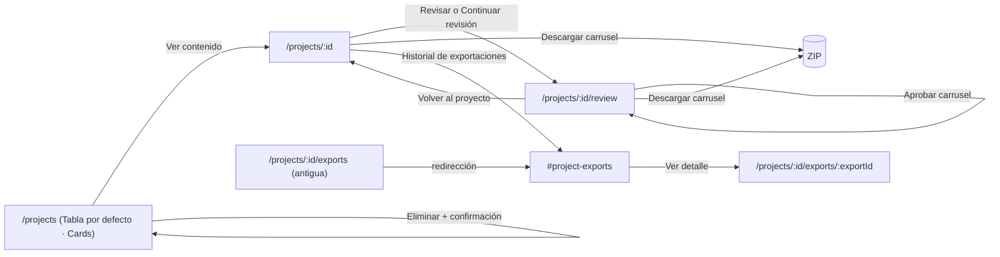

# PD-ARCH-01F — Informe de implementación

## Estado

**Aceptada por el Product Owner el 2026-11-05** y cerrada en `work/PD-ARCH-01F`, creada desde el cierre de
PD-ARCH-01E-A `f63e95cd34759b24ad55ec630d5c4f9499aae001` (aceptada el 2026-11-05). PD-ARCH-01E-B sigue pendiente y no se
implementa aquí.

## Principio aplicado

El proyecto es el centro de la experiencia. Ver contenido abre siempre `/projects/:projectId`, en cualquier estado. La
revisión, la aprobación, la regeneración, la exportación y la descarga se ofrecen desde el proyecto o su revisión,
reutilizando los servicios y contratos existentes. No se creó ningún sistema paralelo.

## Arquitectura reutilizada

- Listado: `listProjects` (con dos campos nuevos en el resumen) y `ViewModeToggle`, el selector Tabla/Cards de 01D-D.
- Detalle: `getProject`, `getActiveDraft`, `ReviewWorkspace` y `ReviewThumbnailRail`; selector de carruseles
  existente; sección de generación con ejecución completa y redraft (regenerar).
- Revisión: `ReviewPage` y `CarouselReview` sin cambios funcionales en aprobaciones, retiro, regeneración, aprobar
  todas, copy ni aprobación final.
- Exportación y descarga: `exportCarousel`, `listProjectExports`, `downloadExport`, `DownloadExportButton` y la página
  de detalle de exportación con su traza.
- Componentes y tokens del design system: `Button`/`buttonClassName` (primary, secondary, danger), `Badge`, `Modal`,
  `ModalFooter`, `ErrorBanner`, `LoadingState`.

## Navegación

## Listado `/projects`

- Vista **Tabla** por defecto y vista **Cards** con el selector `ViewModeToggle` (estado local; Tabla al entrar).
- Columnas: proyecto, tipo de contenido, contexto deportivo resumido, estado, fecha de creación y acciones. Las Cards
  muestran los mismos datos y acciones.
- Tipo de contenido: `Carrusel de resultados` para proyectos de catálogo; el tipo de pieza (`Resultados de jornada`,
  `Resultado individual`) para piezas generadas desde una competición local.
- Estado: `En generación` (ejecución pendiente o en curso), `Generación fallida` (ejecución fallida sin contenido) o el
  resumen de aprobación (`En preparación`, `Pendiente de revisión`, `Listo para descargar`, `Exportado`).
- Acciones en todos los estados: **Ver contenido** (primary, siempre al detalle) y **Eliminar** (danger).
- Tras eliminar, la fila desaparece sin recargar y se anuncia el resultado en una región `aria-live`.

## Eliminación

### Estrategia

La arquitectura aprobada de WI-1 establece **OD-08**: las filas nunca se borran y los registros sustituidos o
invalidados llevan una marca de tiempo (data-model.md §2 y §7; R-043, R-044, R-220). Reutilizando esa convención, la
eliminación es **lógica**: migración aditiva `0020_project_deletion.sql` con `projects.deleted_at`.

- Todas las lecturas excluyen los proyectos eliminados: proyectos, ejecuciones, research, verificación, contenido,
  publicabilidad, revisión (incluidos carrusel y elementos), imágenes, exportaciones, descargas y trazas. Cualquier
  ruta de un proyecto eliminado responde `404 NOT_FOUND`, también las de carrusel o exportación por ID.
- Ninguna ejecución puede iniciarse sobre un proyecto eliminado, y ninguna etapa en curso puede escribir sobre él: cada
  etapa resuelve el proyecto y no lo encuentra.
- Se conservan en disco y en la base las filas y archivos propios del proyecto (borradores, versiones, aprobaciones,
  exportaciones, renders, ZIP) para la trazabilidad. Un borrado físico contradiría OD-08 y requiere decisión del PO.
- No se modifican competiciones, temporadas, equipos, jornadas, partidos, resultados, plantillas, recursos de marca ni
  otros proyectos. Una pieza de un lote cuyo proyecto se elimina aparece como `deleted` en el lote.

### Operaciones en curso

`DELETE` cancela primero las ejecuciones del proyecto (`WorkflowRunner.cancelProject`) y **espera la confirmación** del
runner (hasta 15 s). Solo entonces registra la lápida en `BEGIN IMMEDIATE`, comprobando que no quede una ejecución
activa. Si la ejecución no confirma su parada, responde `409 RUN_IN_PROGRESS` y no cambia nada: la interfaz no afirma
una cancelación que el backend no confirmó.

### Contrato e idempotencia

`DELETE /api/v1/projects/{projectId}` (`deleteProject`, cabecera de cliente obligatoria, sin cuerpo):

| Caso | Respuesta |
| --- | --- |
| Proyecto visible, en cualquier estado | `204` |
| Proyecto ya eliminado (reintento) | `204`, sin cambios |
| Ejecución que no confirma la cancelación | `409 RUN_IN_PROGRESS` |
| ID inexistente | `404 NOT_FOUND` |
| ID inválido | `400 VALIDATION_FAILED` |

No hay eliminación por GET. Los mensajes de error usan texto fijo, sin rutas ni datos internos.

### UX

Eliminar (danger) abre un modal que identifica el proyecto y explica el alcance real: deja de aparecer y no se puede
abrir; la generación en curso se cancela; las competiciones, plantillas, marca y demás proyectos no cambian; el
historial se conserva internamente y la acción no se deshace. Ofrece Cancelar y **Eliminar proyecto**, con loading,
botones deshabilitados durante el envío y error visible sin cerrar el modal.

## Detalle `/projects/:projectId`

- Encabezado: título, tipo de contenido, estado, fecha de creación y de última exportación, y el contexto deportivo
  cuando existe.
- Contenido primero: carruseles con selector cuando hay varios, miniaturas, vista previa y datos de la diapositiva.
- Acciones del carrusel seleccionado: **Descargar carrusel** (primary) cuando su aprobación final es válida; **Revisar
  contenido** o **Continuar revisión** (primary, o secondary si ya puede descargarse).
- Sin contenido: aviso y **Continuar creación** o **Regenerar contenido** si la última generación falló; la sección de
  generación se abre sola en esos casos.
- **Historial de exportaciones** colapsable (`#project-exports`), cargado solo al abrirse: fecha, carrusel, estado
  (Vigente o Sustituida), número de imágenes, descarga y detalle con las versiones exactas.

## Revisión `/projects/:projectId/review`

- Encabezado contextual: nombre del proyecto, tipo de contenido, contexto deportivo y estado, además del carrusel
  seleccionado y el resumen de aprobación existentes.
- **Volver al proyecto** (secondary) en la barra de herramientas.
- Todas las funciones de revisión se conservan sin cambios.
- Con aprobación final válida: **Descargar carrusel** y un enlace secundario al historial del proyecto.

## Exportaciones y descargas

- Aprobación, preparación y descarga siguen siendo operaciones separadas, conectadas por `CarouselDownload`.
- Una exportación es **vigente** solo si su `finalApprovalId` es la aprobación final válida actual del carrusel. Si
  existe, se descarga sin volver a exportar; si no, se exporta y luego se descarga.
- Las exportaciones de una aprobación anterior (por ejemplo, tras regenerar) nunca se reutilizan: la regeneración
  invalida la aprobación final con las reglas existentes y la nueva aprobación exige una nueva exportación.
- Con varios carruseles, la descarga opera sobre el carrusel seleccionado (`Descargar carrusel N de M`).
- Un `FINAL_APPROVAL_REQUIRED` o `VERSION_CONFLICT` informa que la aprobación ya no es válida y recarga el borrador.

## Refinamiento: un único punto de entrada para Crear contenido

Decisión del PO: `/projects/generate` es el punto de entrada principal de la creación de contenido deportivo.

- **Entradas actualizadas a `/projects/generate`:** el botón principal del shell, la entrada «Crear contenido» del
  menú y de la barra lateral (incluido su estado activo), el CTA del hero de Mis proyectos y el CTA del estado vacío.
  Se retiró del hero el acceso duplicado «Generar desde una competición». La jornada de Competiciones sigue enlazando
  al wizard con su contexto.
- **`/projects/new` retirado de la interfaz (decisión del PO):** el flujo de catálogo fallaba de forma estructural con
  datos del proveedor (por ejemplo, la UEFA Champions League: `invalid` en `/teams/14/name`, porque un nombre del
  proveedor no cumple la regla de nombres y no había forma de corregirlo). Su contenido `LIVE_DATA` de una sola fuente
  nunca podía aprobarse ni exportarse (PD-02), la demostración es sintética y las importaciones manuales de WI-1 quedan
  sustituidas por las competiciones locales y las importaciones de 01D. La dirección redirige al wizard; se eliminaron
  `CreateProjectPage` y su prueba; Importaciones enlaza a Crear contenido y conserva sus importaciones como historial.
  **Se mantienen** las operaciones `createProject` y de catálogo del backend, sus contratos y todos los proyectos
  existentes, que se abren, revisan y exportan igual. Retirarlas sería una limpieza de contrato posterior.
- **Sin contexto** (`/projects/generate`): no se preselecciona ninguna competición ni temporada.
- **Desde una jornada** (`?competitionId=&seasonId=&roundId=`): cada identificador debe ser un UUID y cada nivel
  necesita el anterior. Se validan por niveles contra los datos locales: la competición debe existir, la temporada
  debe pertenecer a ella y la jornada a la temporada. Cada nivel se consulta solo tras validar el anterior, de modo que
  nunca se usa un ID con una competición o temporada ajena. La fase se resuelve desde la jornada. Un contexto inválido
  muestra un aviso comprensible y conserva solo la parte válida; el operador puede cambiar cualquier selección.
- El shell titula `/projects/batches/:id` como «Resultado de la generación»; antes lo trataba como un proyecto.
- Pruebas: `App.test.tsx` (shell, menú y hero hacia el wizard; redirección de `/projects/new`), Importaciones y
  `GenerateContentPage.test.tsx` (sin contexto, precarga con fase, IDs malformados, de otra competición o temporada,
  inexistentes y cambios tras la precarga).

## Compatibilidad de rutas

- `/projects/:projectId/exports` redirige a `/projects/:projectId#project-exports`, que abre el historial. Los enlaces
  existentes no se rompen.
- `/projects/:projectId/exports/:exportId` y su traza se conservan como vistas secundarias: muestran las versiones
  exactas exportadas. Su «Volver» lleva al historial del proyecto.
- `/exports` (historial global) no cambia. No se elimina ningún endpoint ni contrato.
- Se retiraron los componentes sin uso `ExportsPage`, `ExportAction` y `LatestExportDownload`; este último descargaba
  la exportación más reciente del proyecto sin distinguir carrusel ni vigencia.

## Contratos

- Nueva operación `deleteProject` (Zod y OpenAPI).
- `ProjectSummary` (y por tanto `Project`) agrega `latestRunStatus` (estado de la última ejecución o `null`) y
  `sportsContext`, que se movió del detalle al resumen para el listado.
- `ContentBatchItemStatus` agrega `deleted` y `ContentBatch.totals` agrega `deleted`.

## Persistencia

Migración aditiva `0020_project_deletion.sql` (`projects.deleted_at`). No se reescribe ni elimina ninguna fila.

## Pruebas

| Ámbito | Archivo | Cobertura |
| --- | --- | --- |
| Integración y persistencia | `test/integration/delivery/project-deletion.test.ts` | Proyecto sin ejecuciones, con ejecución fallida, aprobado y exportado, y con ejecución activa (cancelación confirmada, sin escrituras posteriores); cierre de todas las rutas; filas y archivos preservados; otros proyectos, catálogo, plantillas y marca intactos; reintento `204`; inexistente `404`; nueva ejecución rechazada. |
| Lotes | `local-content-batches.test.ts` | Pieza eliminada marcada `deleted`; competición, partidos y otras piezas intactos. |
| Runner | `workflow/runner.test.ts` | Cancelación sin ejecuciones, cancelación confirmada y no confirmada a tiempo. |
| Esquema | `migrations.int.test.ts`, `schema.int.test.ts` | Migración 0020 y columna `deleted_at`. |
| Contrato | `test/contract/*` | OpenAPI/Zod y `deleteProject` servido (204, reintento 204, 404 posterior). |
| UI listado | `ProjectListPage.test.tsx` | Tabla por defecto, Cards, mismos datos y acciones, Ver contenido al detalle y Eliminar en cada estado, confirmación, cancelación, loading, error y actualización inmediata. |
| UI detalle | `ProjectDetailPage.test.tsx` | Descarga del carrusel aprobado reutilizando su exportación, historial colapsable sin peticiones previas, historial de borradores anteriores, redirección de la ruta antigua. |
| UI revisión | `ReviewDownload.test.tsx`, `FinalApproval.test.tsx` | Contexto del proyecto y Volver al proyecto; descarga solo con aprobación válida; reutilización, exportación obsoleta, carrusel seleccionado y aprobación invalidada. |

Resultados (2026-11-05):

- Typecheck, ESLint y Prettier dirigidos, build y `git diff --check`: correctos.
- Unitarias (servidor y web): 126 archivos, 2275 pruebas; 2273 correctas y los 2 fallos preexistentes de migas de pan.
- Integración: 48 archivos, 581 pruebas correctas. Contrato: 7 archivos, 1728 pruebas correctas.
- No se ejecutaron E2E ni automatización de navegador; todas las pruebas usan bases y directorios temporales.

## Limitaciones

- Eliminación lógica: los datos y archivos del proyecto eliminado permanecen en el directorio de datos (OD-08). Una
  purga física necesita una decisión del PO.
- La cancelación espera como máximo 15 segundos; después responde `409` y puede reintentarse.
- No hay papelera ni restauración en la interfaz.
- La vista elegida (Tabla o Cards) no se recuerda entre visitas: el listado siempre abre en Tabla.
- El estado del listado deriva de la última ejecución y del resumen de aprobación; no se infiere otra información.
- `SelectionFields`/`selection.ts` conservan los campos del catálogo aunque solo se use el selector de idioma, y el
  cliente web conserva las operaciones de catálogo; se pueden retirar con la limpieza de contrato.
- Las pruebas preexistentes de migas de pan `App.test.tsx` y `ReviewPage.test.tsx` siguen fallando como en `698b90d`.

## Validación manual

1. `npm run dev` (aplica `0020` al arrancar).
2. Abrir `/projects`: comprobar Tabla por defecto, columnas y cambio a Cards.
3. Pulsar Ver contenido en proyectos de distintos estados: siempre abre el detalle.
4. En el detalle de un proyecto aprobado, descargar el carrusel; abrir el historial y comprobar Vigente/Sustituida.
5. Revisar contenido: ver el encabezado del proyecto, volver al proyecto, aprobar y descargar desde la revisión.
6. Regenerar una diapositiva tras exportar: la descarga anterior no se reutiliza y la aprobación debe repetirse.
7. Abrir la dirección antigua `/projects/<id>/exports`: redirige al historial del detalle.
8. Eliminar un proyecto de prueba (cancelar primero, luego confirmar); comprobar que desaparece de la lista y que su
   dirección ya no abre. Probar también con una generación en curso.

## Estado Git

- Rama: `work/PD-ARCH-01F`. Base: `f63e95cd34759b24ad55ec630d5c4f9499aae001` (cierre de 01E-A).
- PD-ARCH-01F cerrada mediante commit; sin merge, sin push y sin deploy.
